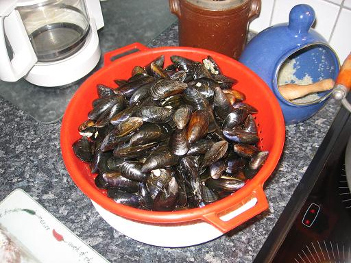
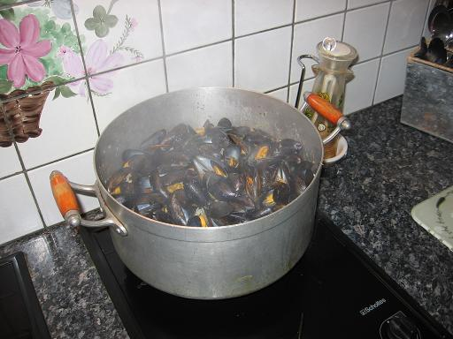
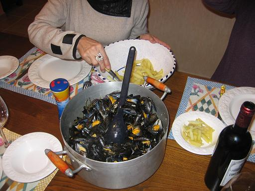

## Ingrédients

- 1 kg de moules fraîches nettoyées et ébarbées
- 1 grand verre de Muscadet de Sèvre-et-Maine sur lie
- 4 échalotes hachées
- 1 gros oignon émincé
- 1 gousse d'ail d'Arleux hachée
- 1 petit bouquet de persil plat haché
- 50 g de beurre demi-sel au sel de Guérande
- 2 pincées de poivre du moulin
- 2 pincées de quatre-épices

## Préparation

1. Dans une grande cocotte ou faitout, faire fondre à feu doux les échalotes, l'oignon et l'ail avec la moitié du beurre demi-sel, sans laisser brunir.
2. Remuer pendant 3 minutes jusqu'à ce que le mélange prenne une belle couleur dorée.
3. Verser le Muscadet, poivrer, remuer et laisser réduire à feu vif pendant 5 minutes.
4. Jeter les moules dans la cocotte, couvrir et remuer de temps en temps jusqu'à ce que toutes les coquilles soient bien ouvertes.
5. Retirer les moules à l'écumoire et les réserver au chaud sous un couvercle.
6. Ajouter au jus de cuisson le persil haché, les quatre-épices et le reste de beurre demi-sel (ou une touche de crème fraîche), puis laisser réduire encore 5 minutes.
7. Remettre les moules dans le faitout, mélanger vivement pour bien les enrober de sauce et servir immédiatement dans le plat de cuisson.

## Observations

- **Contexte :** Recette préparée bien des fois par Mamy de Rennes. Toujours parfaites (Mamy et la recette) ! Réalisée à Quiberon avec Michel et Andrée le 18 novembre 2006. Michel avait confectionné des frites maison avec maestria (cf. recette n°107) en accompagnement : sublime avec une salade d'endives au vinaigre balsamique et un Margaux 1997 rapporté par William et Isabelle de leurs vacances d'été à Lacanau.
- **Variante :** On peut remplacer la seconde moitié de beurre par 2 cuillères de crème fraîche épaisse pour une sauce marinière encore plus onctueuse.
