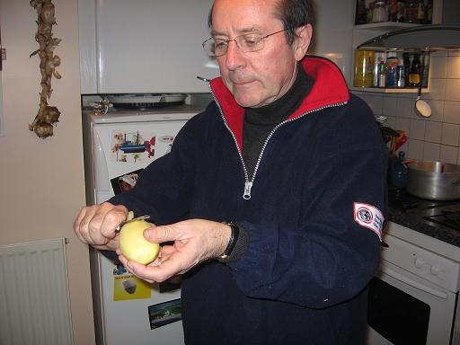
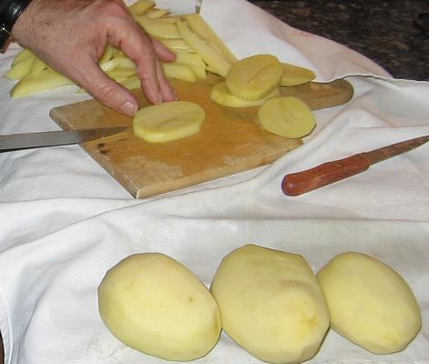
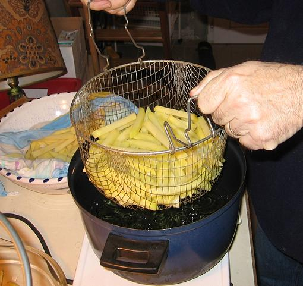

## Ingrédients

- 3 belles pommes de terre à frites par personne
- 2 litres d'huile à friture
- sel selon goût

## Préparation

- éplucher les pommes de terre
- mettre l'huile à chauffer dans la friteuse
- découper les pommes de terre en bâtonnets de 1cm x1cm
- jeter les pommes de terre dans l'huile bouillante et laisser cuire pour les ramollir
- sortir les pommes de terre de l'huile et égoutter
- remettre dans l'huile pour dorer les frites
- sortir, saler et servir aussitôt

## Observations

1 - recette exécutée à Quiberon le 18 novembre 2006 par Maître Michel du Bourny avec un brio dont il a le secret ; ces frites étaient absolument divines ; les convives (outre Maître Michel lui-même, son épouse Madame Andrée du Bourny, et nous deux).
2 - frites servies avec des moules marinières faites par Mamy de Rennes (cf. recette n°106) avec une petite salade d'endives au vinaigre balsamique et un Margaux rapporté par William et Isabelle de leurs vacances à Lacanau. Repas rare !
