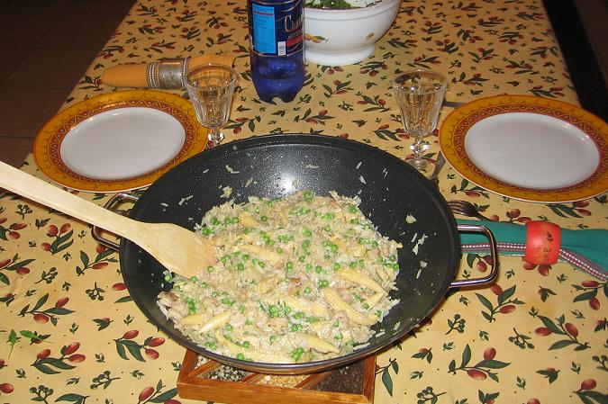

## Ingrédients

- 350 à 400 g de riz thaï ou basmati cuit et froid
- 400 g de crevettes décortiquées
- 2 œufs
- 1 gros oignon émincé en fines lamelles
- 200 g de petits pois (frais ou surgelés)
- 200 g de mini-épis de maïs doux égouttés
- 4 c. à soupe de sauce soja
- 1 petit verre de vin blanc sec ou de xérès (sherry)
- 4 c. à soupe d'huile neutre ou d'olive
- Sel et poivre selon le goût

## Préparation

1. Cuire le riz de préférence à l'avance (ou au cuiseur de riz) et le laisser refroidir pour que les grains se détachent bien.
2. Faire chauffer 2 cuillères à soupe d'huile dans un wok et y faire blondir l'oignon émincé à feu doux sans le brûler.
3. Ajouter les crevettes décortiquées et les saisir 3 à 4 minutes en remuant régulièrement.
4. Verser le vin blanc (ou sherry) et la sauce soja, laisser mijoter 1 minute puis réserver l'ensemble hors du wok.
5. Remettre 2 cuillères d'huile dans le wok bien chaud, y casser les œufs et les brouiller vivement à la spatule.
6. Verser le riz froid dans le wok avec les œufs brouillés, réincorporer les crevettes, puis ajouter les petits pois et les petits épis de maïs.
7. Faire sauter le tout à feu vif pendant 2 à 3 minutes en remuant constamment.
8. Rectifier l'assaisonnement avec un trait supplémentaire de sauce soja, poivrer et saler si nécessaire.
9. Servir brûlant avec une salade verte fraîche.

## Observations

- **Contexte :** Recette exécutée le 19 novembre 2006 à Rennes pour Mamy et moi d'après les précieux conseils culinaires de Madame Jieming de Melbourne.
- **Accompagnement :** Absolument délicieux accompagné d'une petite salade de roquette à l'huile d'olive.
