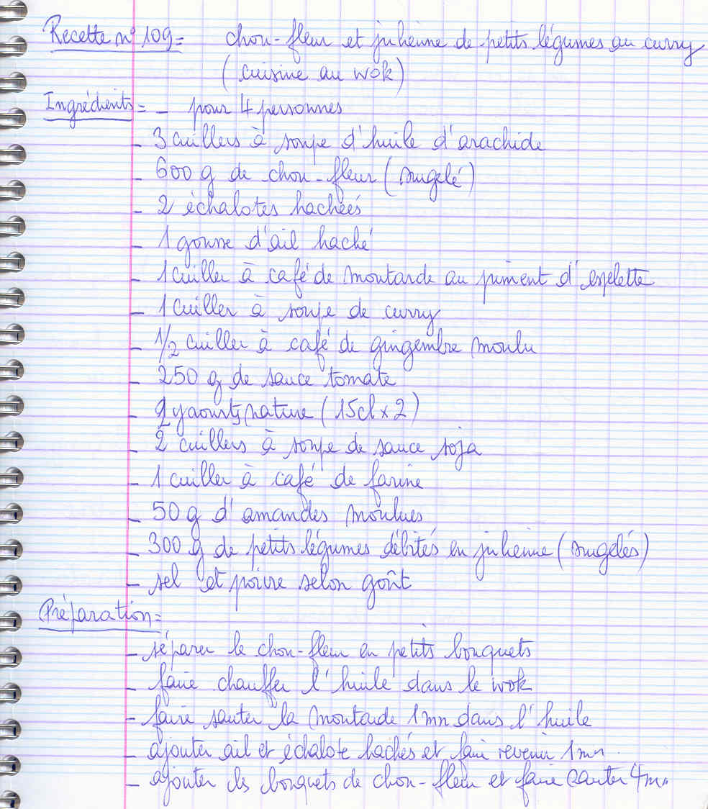
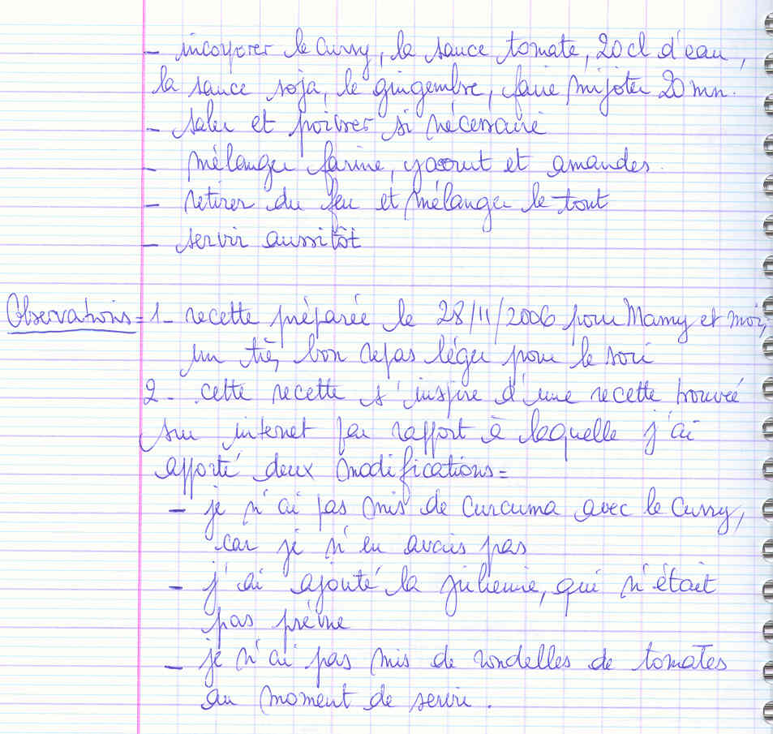

## Ingrédients (pour 4 personnes — cuisine au wok)

- 3 cuillers à soupe d'huile d'arachide
- 600 g de chou-fleur (surgelé)
- 2 échalotes hachées
- 1 gousse d'ail hachée
- 1 cuiller à café de moutarde au piment d'espelette
- 1 cuiller à soupe de curry
- 1/2 cuiller à café de gingembre moulu
- 250 g de sauce tomate
- 2 yaourts nature (15 cl x 2)
- 2 cuillers à soupe de sauce soja
- 1 cuiller à café de farine
- 50 g d'amandes moulues
- 300 g de petits légumes débités en julienne (surgelés)
- sel et poivre selon goût

## Préparation

- séparer le chou-fleur en petits bouquets
- faire chauffer l'huile dans le wok
- faire sauter la moutarde 1 mn dans l'huile
- ajouter ail et échalote hachés et faire revenir 1 mn
- ajouter les bouquets de chou-fleur et faire sauter 4 mn
- incorporer le curry, la sauce tomate, 20 cl d'eau, la sauce soja, le gingembre, faire mijoter 20 mn
- saler et poivrer si nécessaire
- mélanger farine, yaourt et amandes
- retirer du feu et mélanger le tout
- servir aussitôt

## Observations

1. recette préparée le 28/11/2006 pour Mamy et moi, un très bon repas léger pour le soir.
2. cette recette s'inspire d'une recette trouvée sur internet par rapport à laquelle j'ai apporté deux modifications :
   - je n'ai pas mis de curcuma avec le curry, car je n'en avais pas
   - j'ai ajouté la julienne, qui n'était pas prévue
   - je n'ai pas mis de rondelles de tomates au moment de servir.
