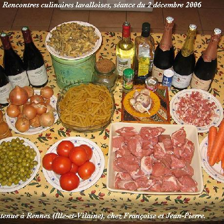

Le 2 décembre 2006 se tenait à Rennes une session des rencontres culinaires lavalloises regroupant 13 convives (Denise et Jean-Claude venus spécialement de Belleuse, Annie et Daniel venus de Laval, Andrée et Michel venus de Laval aussi, Claire et Maurise ainsi que Julie venus de Villiers-Charlemagne, Pierre et Anne venus de Vitré, Mamy et moi ; nous avons fait à cette occsion une variante de l'excellente recette de Marie-Hélène qui est donnée plus avant (recette n°102).

## Ingrédients (pour 13 personnes)

- 2,5 kg de collier de veau coupée en morceaux
- 500 g d'olives vertes dénoyautées
- 300 g de petits lardons, fumés ou non
- 1 kg de carottes
- 1 kg de champignons en boîte
- 4 gros oignons jaunes
- 6 gousses d'ail
- 8 tomates
- 5 cuillers à soupe de farine
- une bouteille de vin blanc
- 3 cuiller à soupe d'huile
- bouquet garni, sel, poivre

## Préparation

- éplucher les oignons jaunes et les débiter en lamelles fines
- éplucher les gousses d'ail et les garder entières
- plonger les tomates dans l'eau bouillantes, les peler et enlever la base de la queue (partie jaune et dure)
- nettoyer les carottes, les débiter en rondelles
- saler et poivrer les morceaux de viande, puis les rouler dans la farine
- dans un wok, faire chauffer l'huile et y dorer 5 mn les morceaux de viande (attention, avec la quantité de viande en question, il faut compter faire cette opération en 2 fois au moins)
- faire dorer les lardons dans le wok, ajouter les tomates, les oignons, l'ail préalablement écrasée avec la lame d'un couteau pour en extraire l'arôme, le bouquet garni ; faire revenir le tout plusieurs minutes en retournant avec la spatule en bois du wok
- mettre viande revenue, lardons revenus avec ail, oignons, tomates, dans une grand faitout, verser le vin, verser 1 litre et demi d'eau, saler et poivrer, couvrir et laisser cuire doucement au moins une heure
- mettre les olives dans une casserole d'eau froide, faire chauffer jusqu'à ébullition, égoutter, ajouter à la viande et laisser mijoter encore une heure
- surveiller pendant que cela mijote et ne pas hésiter à rajouter de l'eau

## Observations

Recette faite le 2 décembre 2006  à Rennes lors d'une session des rencontres culinaires lavalloises regroupant 13 convives (Denise et Jean-Claude venus spécialement de Belleuse, Annie et Daniel venus de Laval, Andrée et Michel venus de Laval aussi, Claire et Maurise ainsi que Julie venus de Villiers-Charlemagne, Pierre et Anne venus de Vitré, Mamy et moi.
