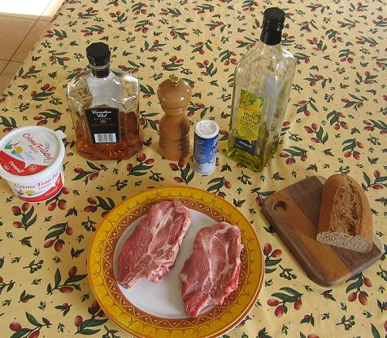
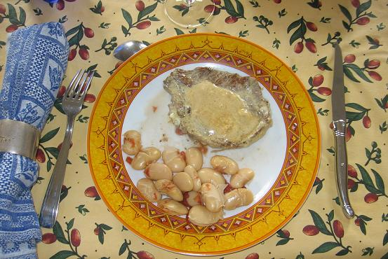

*Pour 6 personnes*

## Ingrédients

### Pour les haricots de Soissons
- 500 g de haricots de Soissons secs (gros haricots blancs de Picardie)
- 400 g de concassé de tomates (1 boîte moyenne)
- 1 gros oignon jaune
- 75 g de bacon émincé
- 4 clous de girofle
- 1 bouquet garni (thym, laurier)
- Sel et poivre du moulin

### Pour l'échine de porc
- 6 belles côtes de porc dans l'échine (plus moelleuses)
- 20 cl de crème fraîche épaisse
- 5 cl de whisky
- 1 c. à soupe d'huile d'olive
- Sel et poivre noir du moulin

## Préparation

1. **Trempage des haricots :** La veille au soir, faire tremper les haricots de Soissons dans un grand volume d'eau froide toute la nuit. Le lendemain matin, les rincer et les égoutter soigneusement.
2. **Cuisson des haricots :** Éplucher l'oignon et le piquer des 4 clous de girofle. Dans un faitout (ou une cocotte-minute), réunir les Soissons égouttés, le concassé de tomates, l'oignon piqué, le bacon en lanières, le bouquet garni, du sel et du poivre dans 2 litres d'eau froide. Cuire 45 minutes à la cocotte-minute après rotation de la soupape, ou 1h30 à 2 heures à feu doux en casserole classique. Réserver au chaud à feu très doux.
3. **Préparation de la viande :** Enduire généreusement les deux faces des côtes d'échine de porc de poivre noir du moulin.
4. **Cuisson et flambage :** Faire chauffer l'huile d'olive dans une grande poêle à feu vif. Y saisir les côtes d'échine et les cuire à cœur en les retournant régulièrement.
5. Saler la viande puis verser la moitié du whisky et flamber aussitôt hors de la hotte. Réserver les côtes de porc au chaud dans un plat de service.
6. **Sauce onctueuse :** Déglacer les sucs de la poêle avec le reste de whisky, puis incorporer la crème fraîche. Laisser réduire et épaissir la sauce quelques instants à feu doux.
7. **Dressage :** Napper l'échine de porc de sauce au whisky et servir fumant, accompagné des haricots de Soissons à la tomate.

## Observations

- **Inspiration :** Mariage réussi de deux traditions : la picarde (les haricots de Soissons avec les côtes de porc) et l'américaine (les steaks flambés au whisky). L'échine apporte un moelleux incomparable et les Soissons restent entiers et majestueux.
- **Contexte :** Recette exécutée le 14 décembre 2006 pour nous deux à Rennes ; un réconfortant et savoureux plat d'hiver !
