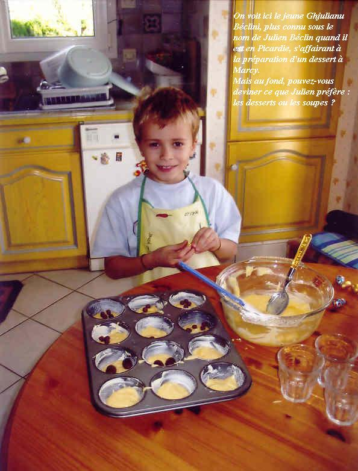

📄 *[Consulter la recette manuscrite originale](image-02.jpg)*

## Ingrédients

- 8 pommes de terre moyennes
- 4 carottes
- 2 courgettes
- 2 blancs de poireaux
- 1 petite boîte de haricots blancs
- 1 petite boîte de haricots verts
- 3 litres d'eau
- 1 c. à soupe de beurre demi-sel
- Quelques feuilles de népita fraîche (ou à défaut cerfeuil, persil ou coriandre)
- Sel et poivre selon le goût

## Préparation

1. Émincer finement les poireaux et les faire suer doucement dans une grande marmite avec le beurre fondu.
2. Éplucher les pommes de terre et les couper en rondelles. Les ajouter dans la marmite et couvrir avec l'eau froide.
3. Éplucher les carottes et les courgettes, les tailler en rondelles et les joindre aux pommes de terre.
4. Porter à ébullition et laisser cuire jusqu'à ce que les légumes soient bien tendres.
5. Égoutter les légumes en réservant soigneusement tout le bouillon de cuisson.
6. Prélever la moitié des légumes cuits et les mixer finement au mixeur plongeant avec un peu de bouillon pour obtenir un velouté onctueux.
7. Reverser la purée mixée dans la marmite avec le restant des légumes entiers et le bouillon réservé.
8. Ajouter les haricots blancs et les haricots verts égouttés.
9. Laisser mijoter l'ensemble à feu très doux pendant 30 minutes au moins pour concentrer les arômes.
10. Saler et poivrer selon votre goût, puis parsemer généreusement de feuilles de népita fraîche avant de servir bien chaud.

## Observations

- **Contexte :** Recette traditionnelle corse exécutée à Quiberon fin février 2007 par le Chef Julien Béclin pour la famille Lafaurie ; une soupe rustique et parfumée, particulièrement réconfortante !
