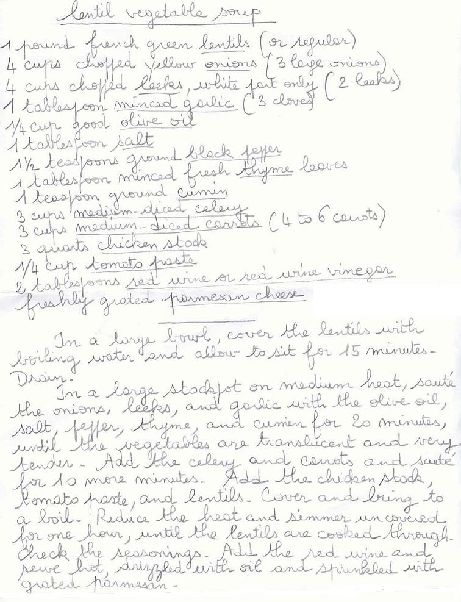

Ingrédients et préparation :

## Observations

- recette rapportée de san José en mars 2007 et réalisée le 14 mars à Rennes pour nous deux ; excellente.
- à noter qu'il serait préférable de modifier l'ordre des préparations en commençant par préparer le bouillon de poule, puis en continuant par préparer tous les légumes avant de les faire revenir.
- comme cette soupe n'est pas passée au mixeur, penser à couper les poireaux en tous petits morceaux (ce sera plus facile à manger).
