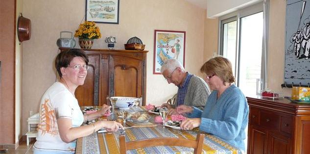
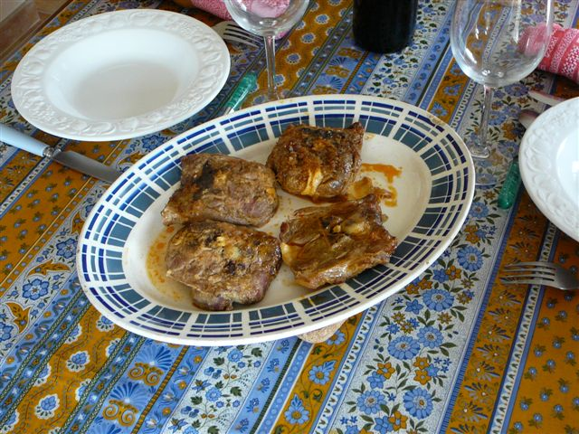
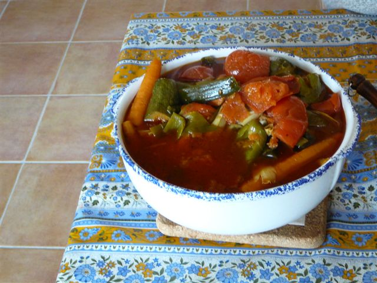

Cette recette s'adresse à ceux qui aiment le couscous "classique"([cf. recette n°16](../0016/recipe.html)) mais qui trouvent que le poulet et le mouton,
quand ils sont cuits avec les légumes, sont trop mous.

Elle consiste à faire cuire séparément viandes et légumes, les premières au four, les seconds au bouillon d'un couscous antérieur,
bouillon qu'on a pris le soin de conserver au congélateur. Moralité : si cette recette vous plaît, ne jetez plus vos bouillons de coucous !

Cette recette a été exécutée en mai 2007 à Quiberon lors de la visite de Christine et Michel.

Ingrédients : pour 4 personnes mais 2 repas
un litre de bouillon de couscous conservé d'un couscous précédent
750 g de graîne de couscous
6 morceaux de poulet
6 morceaux de mouton
3 poivrons verts doux
250 g de pois chiches cuits
250 g de navets
250 g de tomates
une petite boîte concentré de tomates
2 courgettes
2 poireaux
2 navets
1 tube d'harissa
huile d'olive
sel, poivre
thym et laurier

## Préparation

Mettre le bouillon à chauffer et y plonger les légumes (sauf les pois chiches) en commençant par les plus durs (navets) et en finissant par les plus tendres (tomates). Les légumes doivent être complètement recouverts de bouillon (au besoin, compléter par de l'eau et rectifier l'assaisonnement (sel, poivre).
Laisser mijoter à petit bouillon au moins deux heures (quatre heures, c'est très bien !)
Une heure avant de servir, faire cuire au four poulet et mouton.
Une demi-heure avant de servir, prendre du bouillon et mettre les pois chiches à réchauffer doucement.
Un quart d'heure avant de servir, préparer la graîne (mettre dans un saladier avec quelques cuillers d'eau chaude salée, laisser se réhydrater quelques minutes,n mettre queques cuillers de beurre et remuer en chauffant jusqu'à obtention de la bonne consistance).
Servir en plats séparés viandes, graînes, légumes (dans le bouillon ou hors du bouillon), bouillon, sans oublier la harissa qu'on sert à part (tous n'aiment pas ça).

## Observations

1 - Recette exécutée en mai 2007 lors du passage de Christine et Michel ; appréciée mais aurait peut-être été meilleure en immergeant les viandes cuites dans le bouillon un quart d'heure avant de servir : ce sera pour la prochaine fois...
