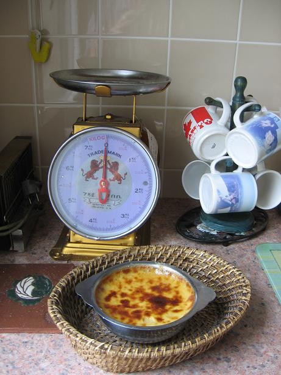

**Recette n°125** :

Oeufs au lait à la chicorée et au caramel de beurre salé.

Ingrédients : pour 4 personnes

- 4 gros oeufs

- 2/3 de litre de lait

- 1 cuiller à café d'essence de vanille

- 1 cuiller à soupe d'extrait de chicorée

- 2 cuillers à soupe de beurre salé
- 70 grammes de sucre en morceaux (pour le caramel)
- 100 grammes de sucre en poudre (pour le lait)

## Préparation

Préchauffer le four à 150°C thermostat 5).

Mélanger le sucre pour le lait au lait et mettre à chauffer à feu doux.

Battre les oeufs comme pour une omelette, les mélanger au lait chaud sucré.

Faire caraméliser le sucre en morceaux dans une casserole avec 2 cuillers à soupe d'eau, en remuant sans cesse à la spatule de bois ; quand le caramel est blond, y mettre le beurre salé et rémuer jusqu'à dilution complète du beurre ; hors du feu, ajouter la chicorée et remuer pour bien homogénéiser ; verser le caramel dans le plat de cuisson pour le four et en napper le fond et les bords.

Mettre ce plat dans un bain-marie et enfourner le tout ; laisser cuire 45 minutes.

Servir assez longtemps avant consommation (se mange froid ou tiède, jamais chaud)..

## Observations

1 - Recette exécutée le 10 juin 2007 à Rennes pour nous deux. Excellent !
2 - Peut se faire sans chicorée et sans beurre salé, mais c'est moins bon.
3 - Peut se faire sans bain-marie, mais la cuisson risque dêtre moins uniforme.
