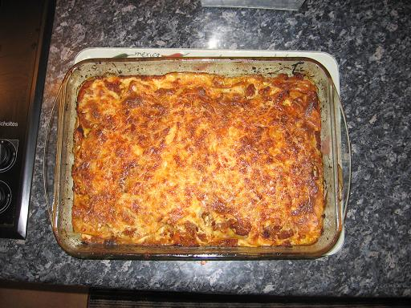

**Recette n°127** :

Lasagnes à la marçoise

## Ingrédients

 pour 8 personnes
- 500 g de viande hachée
- 250 g de chair à saucisse
- 2 petites boîtes de tomates pelées
- 12 lasagnes
-  20 cl de vin rouge
- 3 carottes
- 1 gros oignon
- sel, poivre selon goût
- une poignée de gruyère râpé
- pour la béchamel :
    - 80 g de farine
    - 80 g de beurre
    - 1 litre de lait

## Préparation

1 - préchauffer le four à 200C
2 - débiter les carottes en rondelles

3 - débiter les oignons en rondelles
4 - faire revenir carottes et oignons sans les faire brûler
5 - mélanger avec chair à saucisse, viande hachée, tomates (à ne pas oublier), vin rouge et faire cuire à la sauteuse 30 à 45 minutes en remuant de temps en temps
6 - préparer une béchamel (cf. [recette n°126](../0126/recipe.html))
7 - dans un grand plat allant au four, disposer dans l'ordre :
    - une couche de sauce
    - une couche de lasagnes
    - une couche de sauce
    - une couche de béchamel
    - une couche de lasagnes
    - une couche de sauce
    - une couche de béchamel
    - le gruyère râpé
8 - mettre une louche d'eau sur le pourtour afin que les lasagnes ne brûlent pas en périphérie
9 - enfourner et cuire de 30 à 40 minutes

## Observations

1 - Recette exécutée le 5 juillet 2007 à Quiberon pour Cécile, ses 4 enfants et nous deux. Excellente.
2 - A la suite d'une remarque de Cécile le 24/09/2009, il a été ajouté (au point 5 de la préparation) qu'il ne faut pas oublier les tomates !
