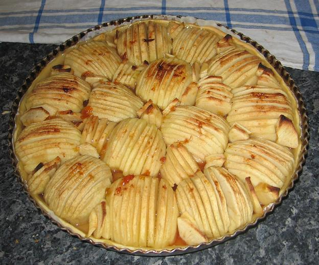

**Recette n°129** :

Tarte épaisse comme les tortues géantes de Philéas Fogg au centre de la terre

Ingrédients : pour 8 personnes

- 10 grosses pommes plutôt tendres
- 4 cuillers de gelée d’arbouses
- 4 cuillers de sucre en poudre
- un verre d'eau
- une pâte à tarte brisée type Marie pour moule de 32 cm environ

## Préparation

- mettre le four à préchauffer à 220C
- dérouler la pâte à tarte et la mettre sur la plaque du four en lui conservant son papier en dessous
- piquer la pâte à la fourchette pour éviter qu’elle ne gonfle
- faire fondre la confiture dans l'eau en chauffant à feu doux pour obtenir un sirop, puis réserver
- éplucher et vider les pommes
- les couper en deux dans le sens vertical et les mettre dans une bassine d'eau froide afin qu'elles ne s'oxydent pas
- quand toutes les demi-pommes sont prêtes, les trancher en lamelles de 5 mm d'épaisseur environ tout en ne les désassemblant pas, puis poser les demi-pommes reconstituées de manière jointives sur la pâte (cf. photo)
- combles les interstices avec de sla melles de pommes (cf. photo)
- arroser du sirop et compléter en saupoudrant du sucre les endroits où le sirop n'est pas allé

- enfourner à four chaud et cuire 35 à 40 mn

## Observations

- recette préparée le 6 juillet 2007 à Quiberon pour Cécile, ses 4 enfants et nous deux. Excellente
