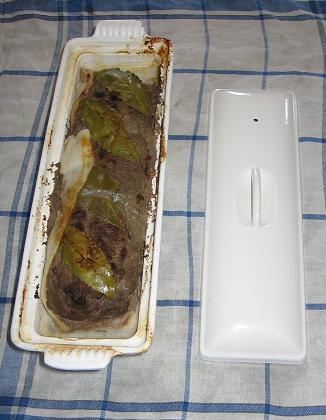

> *Avertissement :* Cette recette traditionnelle nécessite de ne pas être impressionné par la manipulation du foie frais et du hachoir à viande. Prévoir une grande terrine à couvercle et un plat creux pour la cuisson au bain-marie.

*Pour 12 personnes*

## Ingrédients

- 1 kg de chair à saucisse de porc
- 500 g de foie de porc frais (ou foies de volaille à défaut)
- 1 belle barde de lard frais
- 10 échalotes hachées
- 4 gousses d'ail d'Arleux broyées
- 2 gros œufs entiers
- 1 petit verre de porto rouge (ou cognac)
- 8 feuilles de laurier
- 1 grosse pincée d'herbes de Provence (ou thym séché)
- 1 belle pincée de gros sel
- Poivre noir du moulin

## Préparation

1. Préchauffer le four à 200°C (400°F / th. 6-7).
2. Dénerver soigneusement le foie de porc, puis le passer au hachoir à viande (grille moyenne) ou au mixeur.
3. Dans une grande terrine, mélanger intimement le foie haché avec la chair à saucisse, les œufs entiers battus, le porto, les échalotes finement hachées, l'ail écrasé, le gros sel, le poivre et les herbes aromatiques.
4. Repasser l'ensemble au hachoir pour obtenir une farce parfaitement liée et homogène.
5. Tapisser le fond et les parois de la terrine avec la barde de lard en laissant déborder les extrémités.
6. Déposer 4 feuilles de laurier au fond du moule.
7. Remplir la terrine avec la farce en tassant bien pour chasser les bulles d'air.
8. Disposer les 4 feuilles de laurier restantes sur le dessus et rabattre la barde de lard pour fermer la terrine.
9. Poser le couvercle sur la terrine et la placer au centre d'un grand plat rempli d'eau chaude pour la cuisson au bain-marie.
10. Enfourner et faire cuire pendant 1h à 1h15 à 200°C (400°F).
11. Sortir du four et laisser refroidir complètement à température ambiante sans retirer le couvercle.
12. Placer au réfrigérateur pendant au moins 24 à 48 heures avant de déguster pour que les saveurs s'affinent et se consolident.

## Observations

- **Contexte :** Recette traditionnelle préparée à Quiberon le 8 juillet 2007 (nous étions 13 convives à table). La confection réclame un peu de courage au moment du broyage du foie, mais le résultat est d'une finesse incomparable !
- **Dégustation :** Servir tranché épais sur une tranche de pain de campagne au levain avec des cornichons au vinaigre.
