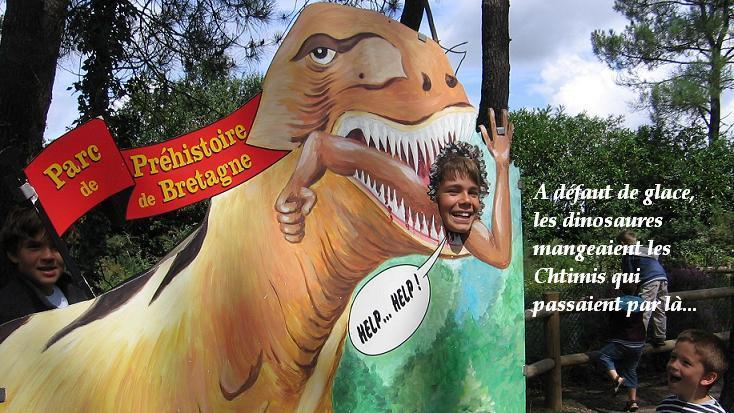

> *« À défaut de glace, les dinosaures mangeaient les Chtimis qui passaient par là… »*  
> *(Photo souvenir prise au Parc de Préhistoire de Bretagne à Malansac).*

## Ingrédients

- 2 pots de yaourt nature velouté (ou yaourt grec)
- 25 cl de crème fleurette très froide
- 15 cl de lait entier
- 100 g de sucre en poudre
- 1 c. à soupe d'extrait naturel de vanille
- 100 g de chocolat noir concassé en fins éclats (stracciatella)

## Préparation

1. **Mélange crémeux :** Dans un saladier, fouetter le yaourt avec le lait, le sucre et l'extrait naturel de vanille jusqu'à dissolution complète du sucre.
2. **Crème :** Monter la crème fleurette bien froide en chantilly souple. L'incorporer délicatement à la spatule dans la préparation au yaourt.
3. **Turbinage :** Verser l'appareil dans la sorbetière et lancer la prise en glace (environ 25 à 30 minutes).
4. **Éclats de chocolat :** Dès que la glace a épaissi et commence à prendre en masse, jeter en pluie les pépites et éclats de chocolat noir pour qu'ils se répartissent sans tomber au fond.
5. **Service :** Déguster aussitôt ou placer au congélateur. À déguster d'urgence avant que les vélociraptors de Malansac ne s'en emparent !
