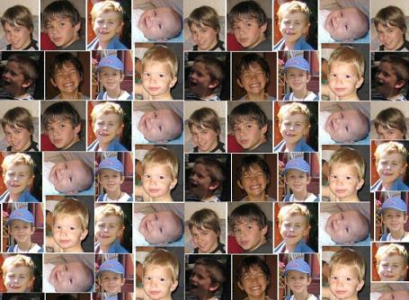

Attention, cette recette est prévue pour 8 personnes gourmandes, ou 6 personnes très gourmandes ; mais évitez d'en faire si les enfants ci-dessous sont près de vous car ils vont ils vont immédiatement la manger toute et vous avec....

## Ingrédients

- une boîte de 200 ml de lait concentré non sucré

- deux tablettes de chocolat blanc de 100 g chacune

## Préparation

- mettre 50 g de chocolat blanc (une demi-tablette) au congélateur pour qu'il durcisse

- battre au mixer ou au fouet le lait concentré non sucré jusqu'à ce qu'il soit crémeux

- faire fondre les 150 g restants de chocolat blanc à feu doux (opération délicate car le chocolat blanc est beaucoup moins gras que le chocolat noir) en remuant sans cesse à la spatule de bois (il ne faut absolument pas que cela brûle).

- mélanger lait battu et chocolat fondu et passer au mixer jusqu'à ce que ce soit très homogène

- passer le tout à la sorbetière

- pendant que la sorbetière tourne, râper le chocolat blanc au congélateur , au besoin en le découpant en petits éclats si le râpage est trop difficile

- quand la glace est prise, y mélanger rapidement les copeaux

-mettre le tout au congélateur

## Observations

- recette préparée à Quiberon le 5 août 2007 pour 8 personnes (Dédée d'Ahuillé, Michel du Bourny, les quatre Béclin du Ch'Nord, les deux Bourdier de Kermorvan)

- tous l'ont bien appréciée, notamment les enfants qui ont effectué un prélavage des plats hors pair.
