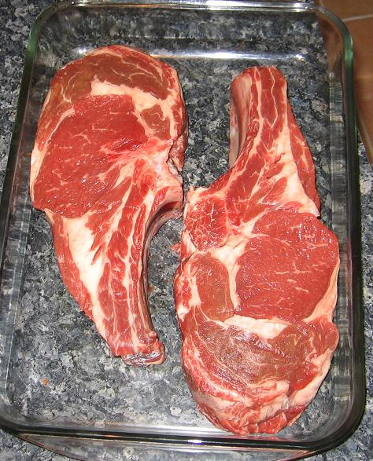
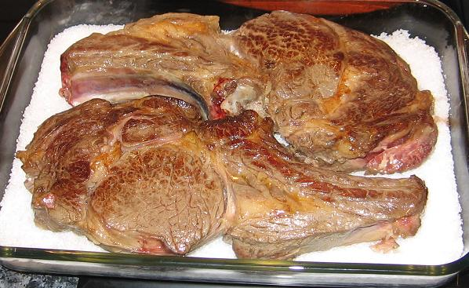
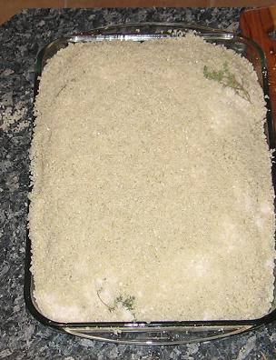
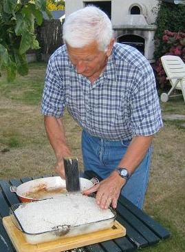
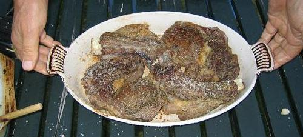
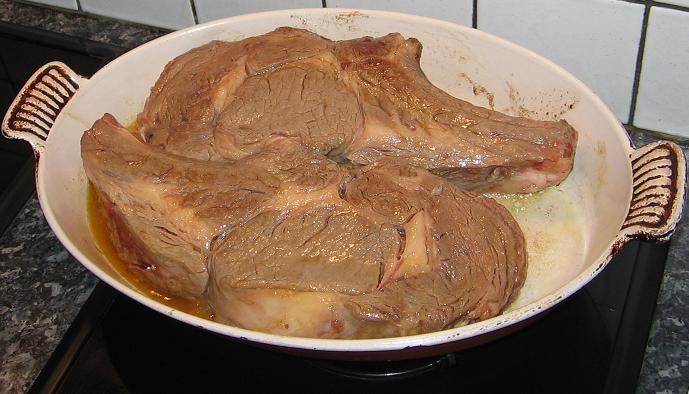

*Pour 4 personnes*

## Ingrédients

- 2 belles côtes de bœuf (de 500 g à 1 kg chacune selon l'appétit)
- 4 à 5 kg de gros sel de mer
- 100 g de beurre demi-sel
- 1 c. à soupe de moutarde forte de Dijon
- 3 c. à soupe d'huile d'olive
- 4 brins de thym frais
- Poivre noir du moulin

## Préparation

1. Sortir les côtes de bœuf du réfrigérateur au moins une heure avant la cuisson pour les amener à température ambiante.
2. Faire ramollir le beurre et le malaxer intimement à la fourchette avec la moutarde forte.
3. Donner quelques tours de moulin à poivre, rouler le beurre parfumé en boudin régulier dans du film alimentaire ou de l'aluminium et le placer au réfrigérateur pour le raffermir.
4. Dans une grande poêle ou sauteuse, faire chauffer l'huile d'olive à feu vif.
5. Y faire dorer vivement les côtes de bœuf sur les deux faces (environ 2 minutes par face pour bien caraméliser les sucs sans cuire l'intérieur), puis les égoutter.

6. Dans un grand plat allant au four à bords hauts, étaler un lit régulier de gros sel de mer de 2 cm d'épaisseur.
7. Déposer les côtes de bœuf dorées sur le lit de sel et garnir de brins de thym frais.

8. Recouvrir entièrement les pièces de viande avec le reste de gros sel en tassant bien à la main pour former une coque hermétique.

9. Préchauffer le four à 220°C (425°F). Enfourner et faire cuire pendant 45 minutes.

10. Au sortir du four, casser la croûte de sel durcie à l'aide d'un couteau lourd ou d'un maillet.

11. Extraire délicatement les côtes et les brosser au pinceau pour éliminer tout résidu de sel en surface.
12. Sortir le boudin de beurre moutardé du froid et le découper en rondelles épaisses.
13. Trancher la côte de bœuf et servir immédiatement avec les rondelles de beurre qui fondront sur la viande brûlante.

## Observations

- **Contexte :** Recette préparée le 17 août 2007 pour l'anniversaire de Françoise Marie-Céline. Nous étions quatre convives (Andrée, Michel, F. et moi) pour 2,2 kg de viande ; un festin mémorable accompagné de pommes de terre en papillotes (cf. recette n°139) et d'un Margaux 2001.
- **Cuisson :** Cette méthode en coque de sel conserve une tendreté et une jutosité incomparables à la viande, tout en lui conférant une saveur intensément saline.
