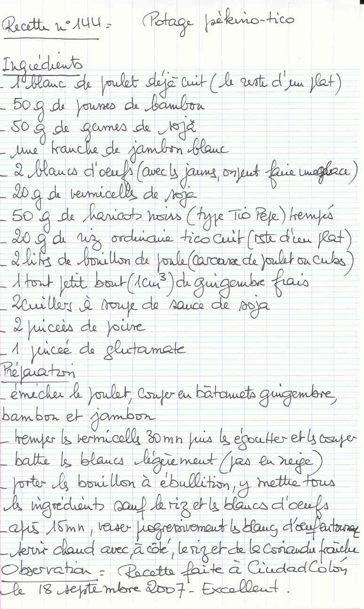

## Ingrédients

- 1 blanc de poulet déjà cuit (le reste d'un plat)
- 50 g de pousses de bambou
- 50 g de germes de soja
- une tranche de jambon blanc
- 2 blancs d'oeufs (avec les jaunes, on peut faire une glace)
- 20 g de vermicelles de soja
- 50 g de haricots noirs (type Tio Pelón) trempés
- 20 g de riz ordinaire tico cuit (reste d'un plat)
- 2 litres de bouillon de poule (carcasse de poulet ou cubes)
- 1 tout petit bout (1 cm³) de gingembre frais
- 2 cuillers à soupe de sauce de soja
- 2 pincées de poivre
- 1 pincée de glutamate

## Préparation

- émincer le poulet, couper en bâtonnets gingembre, bambou et jambon
- tremper les vermicelles 30 mn puis les égoutter et les couper
- battre les blancs légèrement (pas en neige)
- porter le bouillon à ébullition, y mettre tous les ingrédients sauf le riz et les blancs d'oeufs
- après 15 mn, verser progressivement les blancs d'oeufs en tournant
- servir chaud avec à côté le riz et de la coriandre fraîche

## Observations

- Recette faite à Ciudad Colón le 18 septembre 2007. Excellent.
