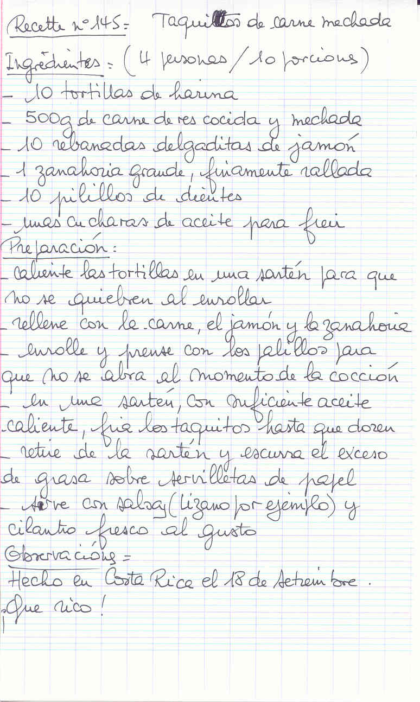

## Ingrédients (4 personnes / 10 portions)

- 10 tortillas de farine
- 500 g de viande de boeuf cuite et effilochée (*carne de res cocida y mechada*)
- 10 tranches très fines de jambon
- 1 grosse carotte, finement râpée
- 10 cure-dents (*palillos de dientes*)
- quelques cuillères d'huile pour frire

## Préparation

- réchauffer les tortillas dans une poêle pour qu'elles ne se brisent pas en les roulant
- garnir avec la viande, le jambon et la carotte
- rouler et fixer avec les cure-dents pour qu'ils ne s'ouvrent pas pendant la cuisson
- dans une poêle avec suffisamment d'huile chaude, faire frire les taquitos jusqu'à ce qu'ils soient bien dorés
- retirer de la poêle et égoutter l'excès de gras sur du papier absorbant
- servir avec une sauce (salsa Lizano par exemple) et de la coriandre fraîche selon goût

## Observations

- Recette faite au Costa Rica le 18 septembre. Délicieux ! (*¡Que rico !*)
