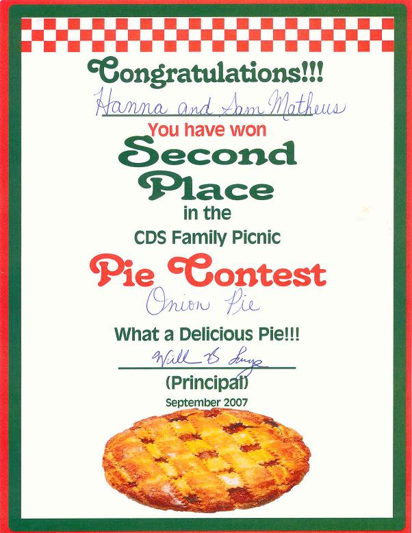

## Ingrédients / Ingredients (for 12 servings)

-         dough (500g)
-         large yellow onions (10)
-         flour (100g)
-         butter (100g)
-         milk (1liter)
-         egg yolks (6)
-         oil (2 tablespoons)
-         salt and pepper (according to taste)

## Préparation / Preparation

-         spray the oil on the piepan
-         spread the dough on the piepan
-         pre-heat the oven (200C, 400F)
-         put the piepan in the oven for 20 mn, then take it out and let it cool down
-         peel and slice the onions
-         sauté them in a frying pan with oil ( they must become darker but not burn)
-         spread the onions on the dough after removing the oil in excess on paper
-         make a white sauce with butter, flour, milk and yolks, salt and pepper
-         spread the white sauce on the onions
-         cook in the oven for 20 mn

## Observation

Cette tarte à l'oignon a valu à Hannah et Samuel Mathews la seconde place au concours international de tartes d'Escazu le 29 septembre 2007 .
