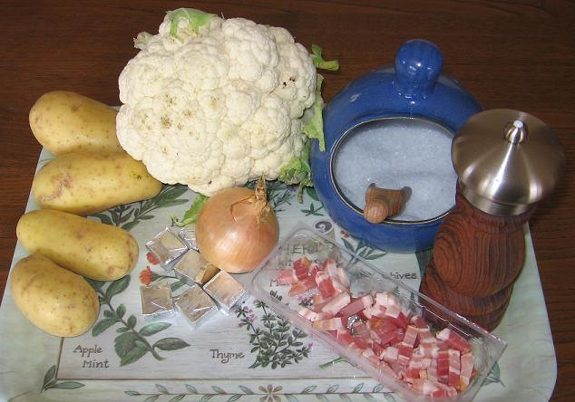
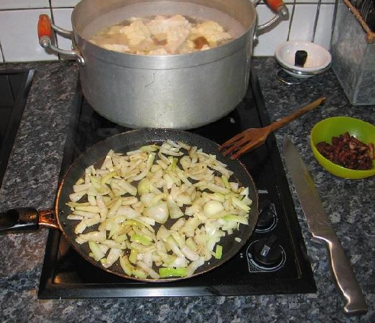

> *Note préliminaire :*  
> Cette recette a été initialement rédigée en allemand pour nos amis radioamateurs Kurt, Lothar et Ivan. La version française est présentée à la suite.

### Deutsche Version

#### Zutaten
*(für 6 Portionen)*
- 1 Blumenkohl, geschnitten
- 4 Kartoffeln, geschält und geschnitten
- 1 Zwiebel, gehackt
- 100 g Speckstückchen, geräuchert
- 6 Würfel Hühner-Kraftbouillon (60 g)
- 2 Liter Wasser
- Salz, Pfeffer und Sahne nach Geschmack

#### Zubereitung
1. Blumenkohl, Kartoffeln und Hühner-Kraftbouillon in kaltes Wasser geben, zum Kochen bringen und weich kochen lassen.
2. Die Speckstückchen in einer Pfanne anbraten und die gehackte Zwiebel im Speckfett glasig dünsten.
3. Angebratene Speckstückchen und Zwiebel zum kochenden Gemüse geben.
4. Alles mindestens 15 Minuten sanft köcheln lassen.
5. Ein Viertel des Gemüses mit einem Schaumlöffel herausnehmen und beiseitestellen. Den Rest mit dem Stabmixer fein pürieren.
6. Das zurückbehaltene Gemüse wieder unterrühren, um der Suppe eine schöne rustikale Textur zu geben.
7. Nach Geschmack mit Salz und Pfeffer abschmecken (vorsichtig mit Salz, die Bouillon ist schon würzig).
8. Heiß servieren, nach Belieben mit einem Löffel frischer Sahne verfeinern.

---

### Version française

*Pour 6 personnes*

## Ingrédients

- 1 chou-fleur coupé en bouquets
- 4 pommes de terre épluchées et coupées en morceaux
- 1 gros oignon jaune haché
- 100 g de petits lardons fumés
- 6 cubes de bouillon de volaille
- 2 litres d'eau
- Sel, poivre du moulin et crème fraîche selon le goût

## Préparation

1. Déposer les bouquets de chou-fleur, les morceaux de pommes de terre et les cubes de bouillon de volaille dans 2 litres d'eau froide. Porter à ébullition et laisser cuire jusqu'à ce que les légumes soient bien tendres.
2. Dans une poêle, faire dorer les lardons fumés à sec, puis faire suer l'oignon haché dans la graisse des lardons.
3. Ajouter les lardons dorés et l'oignon fondu dans la marmite de légumes frémissante.
4. Laisser mijoter l'ensemble à feu doux pendant au moins 15 minutes.
5. Prélever à l'écumoire un quart des légumes entiers et les réserver à part.
6. Mixer le reste de la soupe au mixeur plongeant jusqu'à consistance d'un velouté onctueux.
7. Réincorporer les légumes réservés pour apporter de la texture et de la mâche.
8. Goûter et rectifier l'assaisonnement en poivre et sel (le bouillon apportant déjà une bonne salinité).
9. Servir fumant dans des assiettes creuses avec une cuillère de crème fraîche épaisse pour les gourmands.

## Observations

- **Contexte :** Recette réconfortante préparée le 1er novembre 2007 à Quiberon pour fêter la Toussaint au coin du feu.
- **Texture :** Réserver une partie des légumes avant de mixer donne un velouté rustique très agréable. Ceux qui préfèrent une texture parfaitement lisse peuvent tout mixer.
- **Conservation :** Cette crème de chou-fleur se congèle et se réchauffe remarquablement bien.
