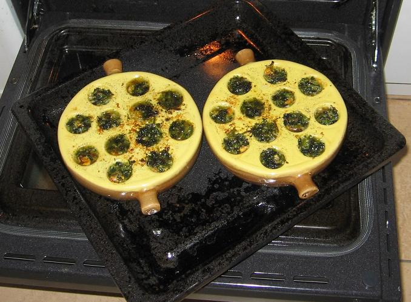
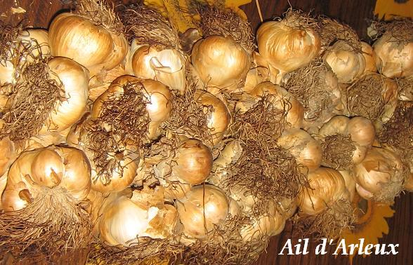

## Ingrédients

pour 4 personnes
- 1 litre de moules de bouchot, de préférence
- 120 g de beurre au sel salé de Guérande
- 1 bouquet de persil
- 2 grosses gousses d'ail d'Arleux

## Préparation

- mettre le beurre à ramollir près du fourneau (mais ne pas le mettre à fondre)
- passer les moules à l'eau froide rapidement, les ébarber une par une (c'est long mais indispensable) en jetant les cassées ou non-vivantes
- les mettre sans eau dans une grande casserole à feu vif, couvrir et faire sauter en tenant le couvercle pour qu'elles chauffent bien toutes
- au bout de quelques minutes (pas plus de 3 à 5, car sinon elles vont durcir), elles doivent pour la plupart être ouvertes
- les égoutter (en gardant et filtrant le jus de cuisson qui peut être congelé et servir à donner du goût à une soupe de fruits de mer plus tard)
- mettre le four à chauffer à thermostat 7
- les écailler une par une, les réserver
- préparer la farce en hachant le persil, en pressant l'ail, en salant et poivrant selon goût, et en mélangeant bien le tout à la fourchette avec le beure ramolli
- dans les alvéoles des poêlons, mettre les moules (de une à 3 par alvéole suivant taille) ; compter 6 alvéoles par convive pour une entrée, 12 pour un plat principal
- compléter par la farce à la spatule (petite cuiller)
- enfourner et laisser la farce bien cuire sans la bruler (une dizaine de minutes devraient suffire)
- servir aussitôt avec des mouillettes pour  aller chercher le beurre fondu dans les alvéoles

## Observations

- recette préparée en octobre 2007 à Rennes pour nous deux dans des poêlons aimablement offerts par Vanvan quand nous sommes passés la voir à Montigny
