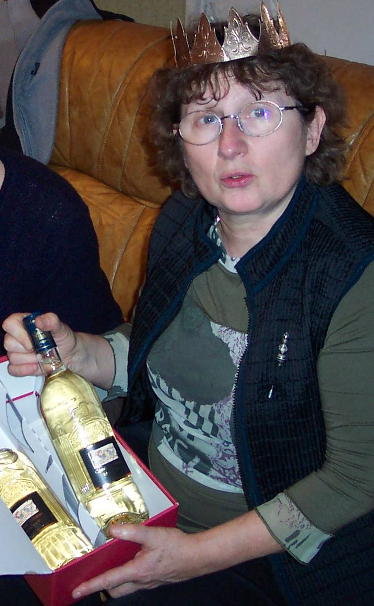

*Pour 6 personnes*

## Ingrédients

- 2 rouleaux de pâte feuilletée pur beurre prête à dérouler
- 125 g d'amandes émondées en poudre
- 150 g de sucre semoule
- 150 g de beurre doux ramolli
- 3 gros œufs entiers
- 1/2 c. à café d'arôme d'amande amère (doser avec parcimonie)
- 1 fève en porcelaine (ou un bouton propre)

## Préparation

1. Dans un saladier, mélanger intimement la poudre d'amandes et le sucre en poudre.
2. Préchauffer le four à 190°C (375°F / th. 6-7).
3. Faire fondre doucement le beurre, le laisser tiédir puis l'incorporer au mélange amandes-sucre à la cuillère en bois (ne pas utiliser de batteur pour ne pas densifier la pâte).
4. Battre deux œufs entiers en omelette et les ajouter à la préparation en remuant délicatement à la cuillère en bois.
5. Casser le troisième œuf, séparer le blanc du jaune et réserver le jaune dans une tasse avec une goutte d'eau pour la dorure (le blanc n'est pas utilisé).
6. Incorporer la demi-cuillère à café d'extrait d'amande amère : la crème frangipane est prête.
7. Dérouler la première pâte feuilletée et découper un disque régulier au diamètre du moule à tarte (utiliser le moule retourné comme emporte-pièce). Réserver ce disque pour recouvrir la galette.
8. Dérouler la seconde pâte feuilletée sur sa feuille de papier cuisson. Soulever délicatement la pâte par sections et saupoudrer un voile de sucre en poudre sur le papier sulfurisé avant de reposer la pâte (cette astuce caramélisera délicieusement le dessous de la galette).
9. Garnir le moule avec cette pâte sur son papier et découper l'excédent de papier aux ciseaux.
10. Étaler uniformément la crème frangipane sur le fond de tarte jusqu'à 2 cm du bord.
11. Glisser la fève dans la frangipane, de préférence vers l'extérieur pour éviter de tomber dessus lors de la découpe des parts.
12. Humecter légèrement le pourtour de la pâte à l'eau avec le doigt.
13. Poser le premier disque de pâte réservé par-dessus et presser délicatement les bords pour bien souder les deux pâtes.
14. Chiqueter les bords au couteau et dessiner de jolies arabesques ou rosaces sur le dessus avec la pointe d'un couteau sans percer la pâte. Ménager une petite cheminée au centre.
15. Badigeonner uniformément toute la surface au pinceau avec le jaune d'œuf réservé.
16. Enfourner et faire cuire pendant exactement 30 minutes jusqu'à ce que la galette soit bien gonflée et brillante. Servir tiède.

## Observations

- **Contexte :** Recette exécutée le 5 janvier 2008 à Quiberon pour Michel et Andrée du Bourny et nous deux ; puis réitérée le 13 janvier à Rennes pour Annie ; une galette croustillante et parfumée qui rivalise avec les meilleures pâtisseries !
- **Astuce du sucre sous la pâte :** Le saupoudrage de sucre sous le fond de pâte apporte un croustillant caramélisé remarquable à la dégustation.
