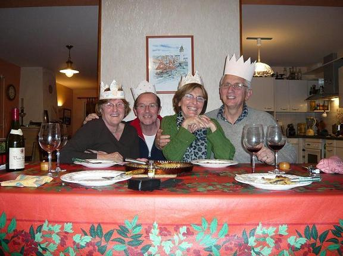

Recette n°167 : galette des rois

Ingrédients : pour 6 personnes (les quantités ne sont pas vraiment critiques, sauf en ce qui concerne l'arôme d'amande amère dont il ne faut pas trop mettre)
- 2 pâtes feuilletées pur beurre du commerce
- 125 g d'amandes émondées
- 150 g de sucre semoule
- 3 oeufs
- 150 g de beurre
- 1/2 cuiller à café d'arôme d'amande amère
- une fève (à défaut, un bouton de culotte passé à l'eau bouillante)

## Préparation

01 - mélanger intimement amandes et sucre
02 - préchauffer le four à 190C (th 6)
03 - faire fondre le beurre, le mélanger à la cuiller de bois (surtout ne pas passer au mixer car cela compacifie) avec le mélange amandes-sucre
04 - battre deux oeufs entiers, les mélanger à la cuiller de bois (surtout ne pas passer au mixer car cela compacifie) au mélange précédent
05 - casser le troisième oeuf, séparer blanc et jaune, réserver le jaune (le blanc ne sera pas utilisé dans la recette)
06 - incorporer la demi-cuiller à café d'arôme d'amande amère (surtout ne pas passer au mixer car cela compacifie) ; la frangipane est prête
07 - étaler une des deux pâtes feuilletée, et la découper au diamètre du moule (utiliser le moule à l'envers comme pochoir), la réserver comme future couverture
08 - étaler la seconde pâte feuilletée sur son papier sulfurisé, la soulever délicatement par parties et saupoudrer le papier de sucre en poudre\*, la remettre à plat
      \*ce sucre en poudre entre le papier sulfurisé et le fond de la tarte donne un aspect et un goût caramélié à la tarte
09 - dans le moule, mettre cette seconde pâte feuilletée sur son papier sulfurisé et en relever les bords le long du moule
10 - découper aux ciseaux le papier qui dépasse
11 -  recouvrir la pâte dans le moule avec la frangipane la frangipane
12 - y enfoncer la fève (le bouton de culotte)
13 - étaler la seconde pâte feuilletée sur la première en enlevant son papier sulfurisé
14 - tracer une rosace à la pointe du couteau
15 - dorer le dessus avec le jaune d'oeuf qu'on a réservé
16 - enfourner, cuire 30 mn (pas davantage, pas moins non plus).

## Observations

- recette exécutée le 5 janvier 2008 à Quiberon pour Michel et Andrée du Bourny et nous deux ; excellent
- recette exécutée aussi le 13 janvier 2008 à Rennes pour Annie de l'Allée de Chevré et nous deux ; excellent encore
