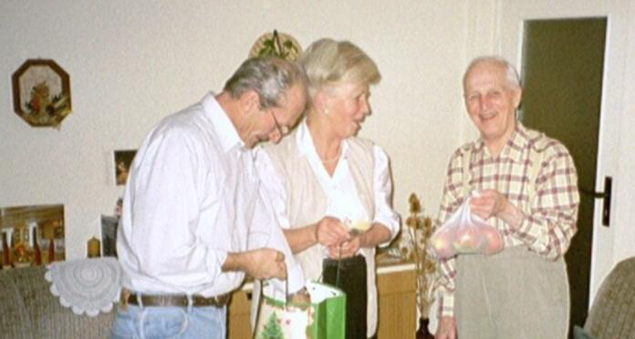
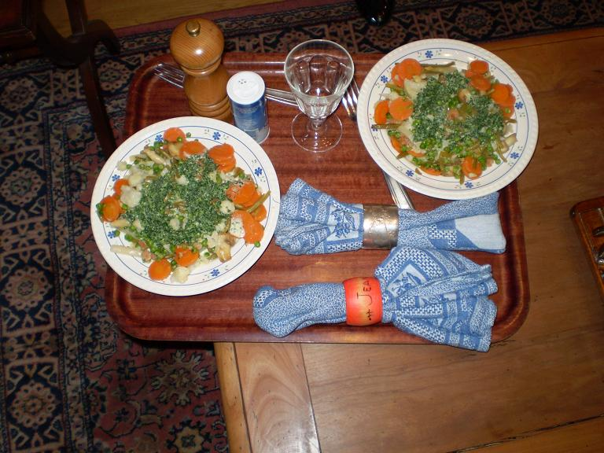

> *Auf dem Foto hierunter sieht man meinen lieben Freund Kurt mit seiner Tochter Marianne und seinem Schwiegersohn Siegfried ; sie haben mir ein schönes Rezeptbuch als Weihnachtsgeschenk geschickt : « Sächsische Küche, ein kulinarischer Streifzug von Leipzig bis Dresden ». Mein erstes Rezept aus diesem Buch ist das Leipziger Allerlei, eine leckere Speise ! Kurt, Marianne und Siggi seien herzlich gedankt !*

*Pour 2 personnes*

## Ingrédients

- 200 g de carottes épluchées et coupées en rondelles fines
- 125 g de chou-fleur détaillé en fleurettes
- 1 chou-rave épluché et taillé en bâtonnets
- 100 g d'asperges en bocal coupées en tronçons
- 100 g de haricots verts coupés en tronçons
- 150 g de petits pois surgelés
- 6 gros champignons de Paris frais lavés et coupés en quatre
- 100 g de crevettes décortiquées (ou chair de crabe égouttée)
- 1 verre de vin blanc sec (environ 10 cl)
- 75 g de crème fraîche épaisse
- 100 g de beurre doux
- 1/4 c. à café de noix de muscade fraîchement râpée
- 1 pincée de sucre en poudre
- 1 petit bouquet de persil plat haché
- Sel et poivre du moulin

## Préparation

1. Faire décongeler les petits pois à température ambiante.
2. Faire sauter les champignons de Paris dans une poêle pendant 5 minutes avec une noix de beurre, puis réserver au chaud.
3. Porter à ébullition 1 litre d'eau dans une cocotte avec une pincée de sel, une pincée de sucre et 1 cuillère à café de beurre.
4. Y plonger les légumes (carottes, chou-fleur, chou-rave, petits pois) sans les remuer et laisser mijoter à feu doux pendant 10 minutes (les légumes doivent rester bien croquants).
5. Égoutter les légumes à l'écumoire, les passer sous un filet d'eau très froide pour fixer leur belle couleur et les laisser s'égoutter. Réserver 100 ml du bouillon de cuisson.
6. Dans une petite casserole, porter à ébullition les 100 ml d'eau de cuisson des légumes réservée avec le verre de vin blanc.
7. Ajouter la crème fraîche et laisser réduire de moitié à feu doux en fouettant régulièrement.
8. Assaisonner la sauce réduite avec le sel, le poivre, une pincée de sucre et la muscade râpée.
9. Dans une poêle, faire fondre la moitié du beurre restant et y faire revenir les crevettes ou la chair de crabe pendant quelques minutes, puis les réserver au chaud.
10. Faire réchauffer rapidement les légumes et les champignons dans le reste de beurre pour les lustrer, saler et poivrer.
11. Disposer harmonieusement les légumes croquants, les champignons et les crevettes sur des assiettes chaudes.
12. Napper l'ensemble de sauce crémée au vin blanc et à la muscade.
13. Parsemer de persil plat fraîchement haché et servir immédiatement.

## Observations

- **Origine :** Recette traditionnelle de Saxe exécutée en janvier 2008 à Quiberon grâce au livre de cuisine offert pour Noël par mon cher ami Kurt Helfer de Dresde, choisi par sa fille Marianne.
