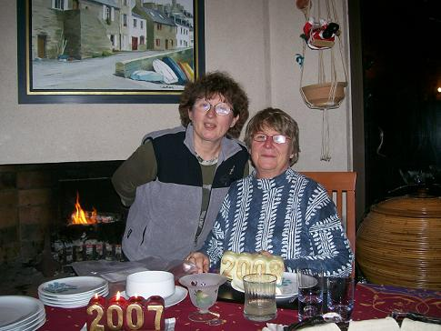

Les gens qui vivent tout près de Molène, au Conquet par exemple, ont un sourire extraordinaire, n'est-ce pas ?

## Ingrédients

*Pour 5 ou 6 personnes*

- 1 beau chou vert pommé (acheté au marché des Lices le samedi matin à Rennes)
- 1 belle saucisse fumée de l'île de Molène (environ 500 g)
- 1 rutabaga ou 1 navet épluché et débité en brunoise
- 1 gros oignon jaune piqué de 4 clous de girofle
- 1 grosse carotte découpée en rondelles
- 1 gousse d'ail d'Arleux écrasée au plat du couteau
- 1 cuillère à soupe de graisse d'oie des Landes (ou de canard, ou de beurre de Guérande)
- Sel et poivre selon le goût
- 2,5 litres d'eau

## Préparation

1. Démonter le chou, laver soigneusement les feuilles et les débiter en tronçons.
2. Faire revenir les feuilles de chou ainsi que la carotte à la graisse d'oie dans une sauteuse.
3. Dans une cocotte-minute, verser 2,5 litres d'eau et y déposer le chou, les carottes, l'oignon, l'ail, le rutabaga et la saucisse coupée en 8 tronçons.
4. Fermer la cocotte-minute et faire cuire 1 heure à partir du moment où la soupape commence à tourner.
5. Ouvrir la cocotte et assaisonner avec sel et poivre selon le goût.
6. Servir bien chaud aussitôt.

## Observations

- **Contexte :** Recette exécutée en janvier 2008 et dégustée avec Annie Lefort-Bourdier (la filleule généreuse donatrice de la saucisse).
- **Service :** C'est un plat consistant qui peut être consommé en soupe (raison pour laquelle il y a tant d'eau) ou en plat complet.
- **Remarque :** Le goût du rutabaga était complètement masqué par la puissance du chou.
