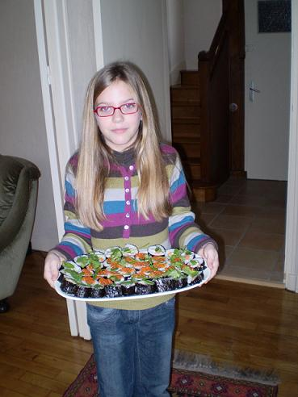
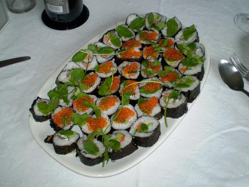
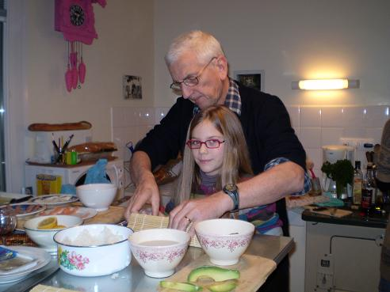
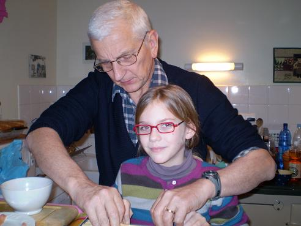
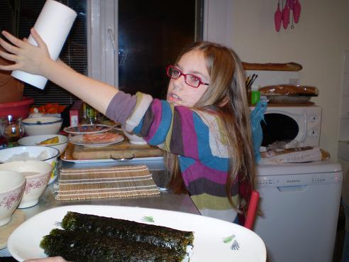
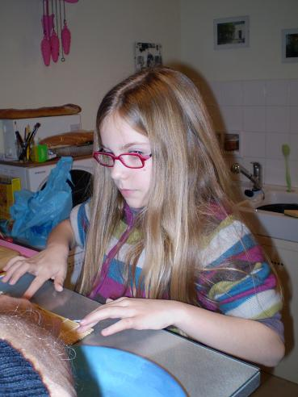

Bonjour ! Je m'appelle Alix et je vais vous expliquer comment on prépare les sushis à la mode de Vitré

En ce 19 janvier 2008, nous étions invités chez Anne et Pierre à Vitré, ce qui nous donna l'occasion de goûter les sushis que prépara gente Dame Alix. Cette recette donne l'occasion de voir quelques photos de ce week-end.

D'abord, voici le plat tel que servi à table, pour vous mettre l'eau à la bouche :

## Ingrédients

- 300 g de riz japonais ou de riz à rizotto
- 5 feuilles de nori (algue noire pour sushis)
- 1 avocat bien mûr coupé en bâtonnets
- 1 tiers de concombre coupé coupé en bâtonnets
- 1 carotte coupée en bâtonnets
- quelques filets de sardines marinées dans le vinaigre
- une demi-tranche de saumon fumé coupé en fines lanières
- quelques bâtonnets de très bon surimi (en choisir du très bon !)
- des oeufs de truite saumonée
- deux cuillers à soupe de vinaigre de riz ou de saké
- une cuiller à café de sucre
- une pincée de gros sel
- quelques brache de menthe et de coriandre (toutes deux très fraîches)
- les sauces qui vont bien avec les sushis (soja, nuoc mam, sauce chinoise pimentée à l'ail, etc)
- les ustensiles nécessaires à la fabrication des sushis (tapis de bambou, couteau très aiguisé ou cutter, film alimentaire transparent)
- du temps et de la patience (se prépare la veille)

La préparation nécessite un peu de manipulation, et l'aide d'un vieux marmiton comme PJP peut être utile

Il faut bien les faire travailler un peu, les vieux, n'est-ce pas ?

## Préparation

1 - porter à ébullition la cuiller à café dissoute dans les deux cuillers à soupe de vinaigre de riz, réserver
2 - rincer abondamment les 300 g de riz jusqu'à ce que l'eau de rinçage soit claire
3 - mesurer le volume du riz, mettre une fois et demi ce volume d'eau dans une casserole, y mettre le riz, remuer et porter à ébullition
4 - quand ça bout, réduire le feu, couvrir et laisser mijoter 15 mn en remuant de temps en temps pour ne pas que cela colleau fond
5 - arrêter le feu, remuer, et laisser couvert 10 mn en remuant de temps en temps : l'eau doit être totalement absorbée par le riz
6 - découvrir, verser le vinaigre de riz sucré et remuer pour bien mélanger, laisser refroidir complètement
7 - préparer tous les ingrédients à portée de main (légumes et poissons découpés) ainsi qu'un beau d'eau froide pour se tremper les mains de temps en temps
8 - sur un tapis de bambou (les tiges étant parallèles au bord de la table), étaler une feuille de nori, "sunny side up" (face brillante dessus)
9 - mouiller légèrement la feuille de nori à la main sans trop traîner car elle commence à rétrécir...
10 - se mouiller les mains (on le refera souvent car le riz colle) et étaler une mince couche de riz (1/2 à 1 cm) sur la feuille de nori jusqu'à 1 cm du bord
11 - composer le coeur du sushis avec poissons et légumes sous forme d'une bande de 3 à 4 cm de large, vers l'extrémité du tapis proche du bord de table
12 - rouler avec l'aide du tapis comme on roule une cigarette : on doit obtenir un gros boudin noir de 5 à 6 cm de diamètre
13 - enlever délicatement le tapis de bambous et rouler immédiatement le sushi dans un film plastique
14 - laisser reposer au frigo jusqu'au lendemain
15 - juste avant le repas, sortir du film plastique et découper en rondelles de 3 à 5 cm d'épaisseur
16 - servir sur un plat avec des oeufs de poisson, des branches de coriandre fraîche, et des feuilles de menthe
17 - servir avec toutes les sauces à disposition dans des coupelles
18 - quand on a oublié (comme nous) d'apporter des baguettes, aller (comme nous) en couper dans un jardin public

il faut penser au papier pour s'essuyer les mains car ça colle vraiment beaucoup

## Observations

Excellent même si nous avions prévu une sauce de trop (la sauce aux huîtres, qui ne va pas du tout avec les sushis ; elle est est par contre excellente avec le veau ou le poulet, mais c'est une autre histoire... cf. recette n°153 du PJP code).

C'est un peu la patouille, cette recette !

Les hôtes avant de commencer à goûter les sushis (remarquer leur regard chargé d'appréhension)

Les mêmes hôtes, repus, après avoir mangé les sushis (non, ils ne sont pas étendus parce qu'ils sont malades)

deux dernières photos : d'abord mon marmiton PJP et sa chef, qui a supervisé le travail

et la chef de mon marmiton, seule en train de digérer

