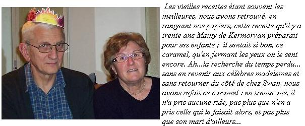

> *Les vieilles recettes étant souvent les meilleures, nous avons retrouvé, en rangeant nos papiers, cette recette qu'il y a trente ans Mamy de Kermorvan préparait pour ses enfants ; il sentait si bon, ce caramel, qu'en fermant les yeux on le sent encore. Ah… la recherche du temps perdu… Sans en revenir aux célèbres madeleines et sans retourner du côté de chez Swann, nous avons refait ce caramel : en trente ans, il n'a pris aucune ride, pas plus que n'en a pris celle qui le faisait alors, et pas plus que son mari d'ailleurs…*

📄 *[Consulter la recette manuscrite originale](image-02.jpg)*

## Ingrédients

- 500 g (1 livre) de sucre cristallisé
- 36 cl d'eau (soit 6 « mignonnettes » Tupperware de 6 cl)
- 1 c. à soupe de vinaigre d'alcool blanc

## Préparation

1. **Démarrage du caramel :** Dans une casserole à fond épais, verser le sucre, 12 cl d'eau (2 mignonnettes) et la cuillère à soupe de vinaigre blanc.
2. **Cuisson :** Placer sur feu très doux sans remuer jusqu'à ce que le sucre fonde complètement puis prenne une belle couleur ambrée et dorée.
3. **Décuisson :** Dès que le caramel est à point, retirer brièvement du feu et verser très prudemment les 24 cl d'eau restants (les 4 autres mignonnettes) pour décuire le caramel.
4. **Finition :** Remettre sur feu doux pendant 2 minutes en remuant doucement pour bien dissoudre la masse et obtenir un coulis de caramel liquide et parfaitement fluide.
5. **Conservation :** Verser dans un flacon ou une bouteille Tupperware hermétique. Se conserve de longues semaines à température ambiante pour napper crèmes, glaces et gâteaux.
