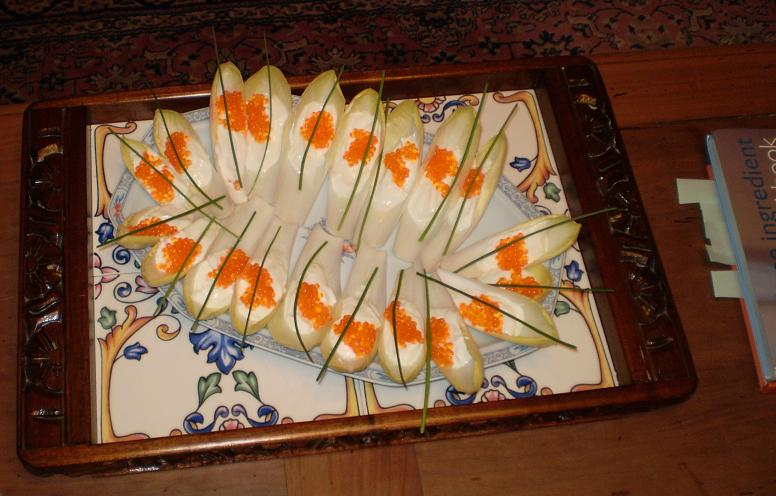

## Ingrédients

- 2 beaux chicons bien frais et bien immaculés
- un pot de 250 g d'un bon fromage blanc frais à 20% (sniff!) de matière grasse
- un petit pot d'oeufs de truite
- quelques brins de ciboulette fraîche

## Préparation

- prélever 4 feuilles de chicons par convive environ
- les disposer sur un plat de service bien à plat
- mettre dans chaque feuille une cuiller à café de fromage blanc, une demi-cuiller d'oeufs de truite, un brin de ciboulette
- conserver au frigo pas plus que quelques heures avant de servir avec un bon crêmant rosé d'Alsace

## Observations

1 - préparé pour Annie de Chevré, Christine et Michel de Bourges, et nous le 24 janvier 2008 : pas une miette n'est restée !
2 - à défaut de ciboulette, on peut mettre de l'aneth
3 - à défaut de fromage blanc, on mettre une chantilly non sucrée
