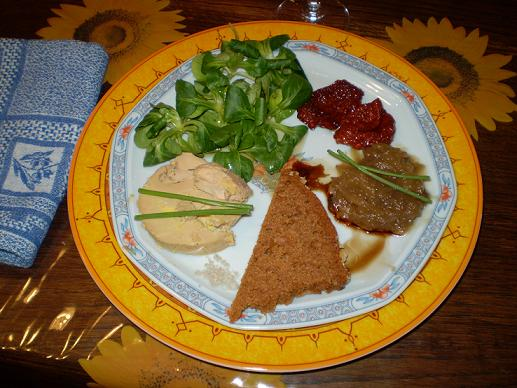

## Ingrédients

- un bloc de foie gras basque découpé en 5 tranches (une par convive)
- 5 poignées de mâche nantaise très fraîche et très propre
- un petit pain d'épices à l'ancienne de Pithiviers, découpé en tranches triangulaires
- un filet d'huile d'olive par assiette
- un filet de vinaigre balsamique par assiette
- 2 cuillers à soupe d'oignons confits de Roscoff par assiette
- 4 brins de ciboulette par assiette
- 2 tomates séchées et conservées dans l'huile par assiette

## Préparation

- présenter comme sur la photo en ayant soin de séparer les ingrédients car tous les convives n'aiment pas forcément tous les ingrédients
- le filet d'huile se met sur la salade, la pincée de sel à part en petit tas, le filet de vinaigre balsamique à part aussi
- conserver au frigo pas plus de quelques heures

## Observations

- recette exécutée en entrée à Rennes le 24 janvier 2008 pour Annie de Chevré, Christine (la photographe) et Michel de Bourges et nous : super bon !
- accompagné d'un excellent vin offert par Andrée d'Ahuillé et Michel du Bourny dà l'occasion de la coupe du monde de rugby (un Tariquet, premières grives, vin moelleux du pays des côtes de Gascogne, 2006)
- on peut remplacer la doucette par des figues fraîches, quand c'est la saison des figues
