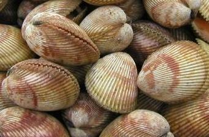

Recette n° 179 : coques aux pâtes (à ne pas confondre avec le coq en pâte)

Les coques sont de savoureux petits coquillages qu'on trouve en Atlantique et en Méditerranée enfouis dans le sable. On peut les pêcher soi-même, mais il faut alors bien veiller à les dessabler, ce qui nécessite du temps car il faut les changer d'eau à plusieurs reprises (de l'eau de mer, bien sûr).
Sur les marchés, on en trouve qui ont été élevés (au Croisic, il y en a beaucoup) et qui n'ont pas de sable dedans.

Contrairement aux moules, quoi ont un ratio "poids de chair"/"poids de coquille" élevé, les coques offrent peu de chair par kg acheté. Il est donc préférable de les manger comme assaisonnement d'un ingrédient plus consistant et les pâtes (spaghetti par exemple) font parfaitement l'affaire.

Ingrédients : pour 4 personnes
- 500 g de spaghetti
- 2 kg de coques
- un gros bouquet de persil plat
- 8 gousses d'ail d'Arleux
- 2 gros oignons jaunes coupés en morceaux
- un verre de Muscadet sur Lie de Sèvre et Maine (ou de vin blanc sec)
- sel (peu) et poivre selon goût
- quatre cuillers à soupe d'huile d'olive
- prévoir de grands récipients : 2 grandes cocottes, un grand saladier, un grand égouttoir

## Préparation

- éplucher l'ail et en faire un hachis avec le persil (on devrait en avoir un demi-bol environ), réserver
- dans une grande cocotte, verser le vin blanc, une cuiller à soupe du hachis et les coques
- mettre à feu vif en remuant à la cuiller de bois jusqu'à ouverture complète des coques (4 minutes environ)
- arrêter le feu, couvrir et réserver la cocotte avec les coques dedans
- préparer les spaghetti en portant à ébullition une grande quantité d'eau salée
- mettre les spaghetti dans l'eau bouillante, remuer pour qu'elles ne collent pas et compter de 7 à 9 minutes de cuisson
- goûter une pâte pour juger de sa cuisson (certains aiment "al dente", d'autres quand c'est "pâteux"...)
- égoutter les pâtes rapidement et non complètement (un peu d'eau de cuisson garantit des pâtes non collantes)
- dans un grand saladier, mélanger soaghetti et hachis, avec l'huile d'olive
- y adjoindre les coques qu'on prendra soin de prélever dans leur cocotte avec une écumoire\* pour laisser le peu de sable qu'elles pourraient encore contenir
- remuer l'ensemble et servir aussitôt, car cela doit se manger chaud (prévoir des récipients pour mettre les coquilles vides)

## Observations

\* le jus de cuisson des coques peut être conservé au congélateur pour une préparation ultérieure (par exemple pour un "chaudron de coquillages du Vadjuner" cf. recette n°105 du PJP code) ; dans ce cas, bien penser à le filtrer avec un filtre en papier avant conservation.
\*\* recette exécutée le samedi 26 janvier 2008 à Rennes pour Christine de Bourges, Annie de Chevré et nous deux. Pas de reste !
