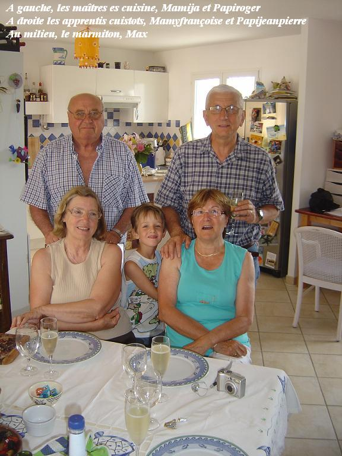

Ingrédients : pour 4 personnes affamées
beaucoup d'eau (on verra ça ci-dessous, dans la préparation)
1 talon de jambon
2 échalotes

2 gousses d'ail d’Arleux

une cuiller à soupe d’herbes du maquis (corse, car il n’y a pas de maquis chez les Ch’tis)

4 petits poireaux

1 tout petit chou vert

4 pommes de terre moyennes

4 navets moyens

4 carottes moyennes
4 petits chicons du Nord

une petite boîte de haricots blancs (s’ils sont de Soissons, c’est encore meilleur)

2 tablettes de bouillon de poule
un croûton de pain dur (pour enlever l'amertume du chou)

une boîte de cassoulet de Castelnaudarry ( de chez Spangherro, le meilleur\* )

une boîte de 4 cuisses de canard confites ( de chez Spangherro, le meilleur\*)

## Préparation (c’est un peu long, mais c’est tellement bon !)

1 - dans 2 grandes cocottes, mettre de l'eau à chauffer : la première servira à la cuisson des légumes autres que le chou, la seconde au blanchiment du chou
2 - peler les pommes de terre, les couper en dés, les mettre dans la 1ère cocotte avec les plaquettes de bouillon de poule
3 - peler les carottes et les navets, les débiter, les mettre dans la 1ère cocotte
4 - peler les échalotes, les couper en quatre ; peler les gousses d'ail et les écraser avec le plat du couteau, mettre le tout dans la 1ère cocotte
5 - nettoyer les poireaux, séparer blanc et vert, couper le blanc en dés, lier le vert en 4 petits fagots (pour qu'ils ne se délite pas) et mettre dans la 1ère cocotte
6 - préparer les chicons, les attacher séparément (pour qu'ils ne se délitent pas), les mettre dans la 1ère cocotte avec les herbes du maquis
7 - nettoyer le chou, le couper en 4, retirer le trognon dur, mettre dans la 2ème cocotte avec le trognon de pain dur
8 - couper le talon de jambon en 2 ou 4 suivant sa taille et mettre dans la 1ère cocotte
9 - quand l'eau bout dans la 1ère cocotte, compter 30 mn de cuisson environ ; puis réduire le feu au minimum pour garder chaud sans cuire davantage
10 - quand l'eau bout dans la 2ème cocotte, compter environ 5 mn de cuisson à gros bouillon pour enlever l'amertume du chou, enlever du feu, vider l'eau dans l'évier, jeter le pain, rincer les quartiers de chou à l'eau tiède, débiter le chou en lanières, le mettre à cuire dans la 2ème cocotte avec au moins un litre d'eau
11 - quand l'eau bout dans la 2ème cocotte, laisser cuire le chou à gros bouillon en le goûtant de temps en temps (il doit être tendre, sinon ce n'est pas bon)
12 - pendant la cuisson du chou, ouvrir la boîte de cassoulet et celle de haricots blancs, couper les saucisses du cassoulet en tranches, et mettre le tout dans la 1ère cocotte, mélanger délicatement
13 - pendant la cuisson du chou, ouvrir la boîte de cuisses de canard, reirer les cuisses de canard de la graisse, enlever la peau, désosser et mettre dans la 1ère cocotte en remuant délicatement
14 - quand , dans la 2ème cocotte, le chou est tendre, le transvaser avec son eau dans la 1ère cocotte, remuer délicatement
15 - réchauffer le tout si ce n'est pas assez chaud, mais cela ne devrait pas être nécessaire.

## Observations

1 - recette d'origine transmise par Papiroger et Mamija qui nous avaient fait connaître ce délice. Merci encore à eux.
2 - la variante ch'tie a été réalisée le 13 mai 2008 à Marcq-en-Baroeul et très appréciée pendant 2 jours.

\* et sa réputation est arrivée jusque chez les Ch'tis.
