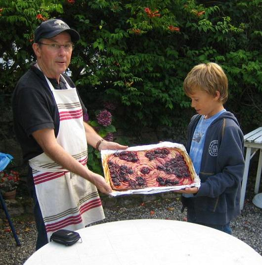
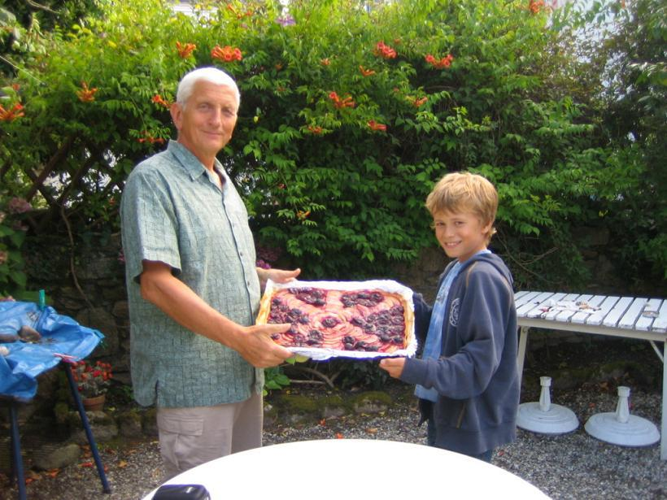

Recette n°201 : Tarte "God save the Quetsche"

Comme aime à dire Julien Béclin quand il exécute une des recettes qui ont fait sa renommée :
"Je suis jeune, il est vrai; mais aux âmes bien nées,
La valeur n'attend pas le nombre des années."

## Ingrédients (pour 8 personnes)

- 6 grosses pommes plutôt tendres
- 1 kg de quetsches
- 8 cuillers à soupe bombées de sucre en poudre
- 2 pâtes à tarte brisée type Marie, pur beurre
**

## Préparation

- mettre le four à préchauffer à 220C
- dénoyauter les quetsches
- éplucher les pommes,  les couper en lamelles, les mettre dans une bassine d'eau froide pour ne point qu'elles s'oxydent
- sur la plaque du four, disposer du papier à cuisson en couvrant bien tout le fond
- dérouler les pâtes à tarte et les mettre sur la plaque du four
- au rouleau ou avec les pouces, souder les deux pâtes en les étirant pour qu'elles couvrent tout le fond
- piquer la pâte à la fourchette pour éviter qu’elle ne gonfle
- disposer pommes et prunes de façon à reconstituer le drapeau de la Grande Bretagne
- saupoudrer du sucre
- enfourner à four chaud et cuire 45 à 60 mn

## Observations

Recette exécutée à Quiberon le 2 août 2008 par Julien Béclin, avec l'aide de deux jeunes marmitons (Michel Pioger et Jean-Pierre Bourdier) pour les familles Béclin, Pioger et Bourdier.
Tout a été mangé !

