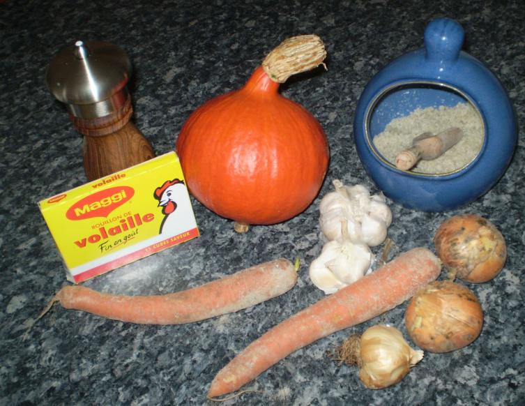

Recette n° 203 : Soupe de potimarron

Ingrédients : pour 4 personnes
- un potimarron de 1,2 kg environ
- 1,5 litre de bouillon de poule
- 3 carottes de la ferme de Kernavest
- 2 gousses d'ail d'Arleux
- 1 gros oignon jaune de la ferme de Kernavest
- 1/2 litre de lait
- une cuiller de margarine
- poivre selon goût (et sel éventuellement, si le bouillon n'est pas assez salé)

## Préparation

- préparer le bouillon de poule
- faire revenir l'oignon découpé en rondelles et l'ail dans la margarine ; ne pas laisser brûler.
- avec un gros couteau, découper le potimarron en 8 tranches.
- le vider de ses graines et de ses fibres centrales, puis l'éplucher.
- le débiter en lamelles ou en dés.
- nettoyer les carottes et les débiter en rondelles.
- mettre à cuire potimarron, ail, oignon, carottes dans le bouillon jusqu'à ce que le potimarron s'écrase à la fourchette.
- attention, remuer de temps en tant à la cuiller de bois car cela a tendance à accrocher au fond de la casserole.
- quand c'est cuit, ajouter le demi-litre de lait, remuer et passer au mixer.
- poivrer selon goût (saler aussi, si nécessaire, mais le sel apporté par le bouillon de poule devrait suffire).

## Observations

- recette faite à Quiberon pour Michel Pioger et nous deux le 24 août 2008 ; nous avons mangé la part de quatre à nous trois ; excellent !
