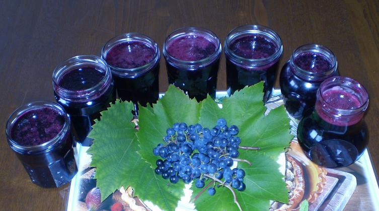

## Ingrédients (pour 7 pots)

- 2,7 kg de grappes bien mûres (qui donneront 2 kg de jus de raisin)
- 1 kg de sucre
- 1 dl de jus de citron

## Préparation

- on lave les grappes (elles sont pleines de bestioles), et on les égraine
- on presse pour extraire le jus sans la peau, sans les pépins
- on mélange jus de raisin, sucre et jus de citron
- on fait cuire jusqu'à obtenir la bonne viscosité (une goutte sur une assiette ne doit pas couler)
- on met en pots suivant le processus habituel

## Observations

- recette préparée en août 2006 à Quiberon pour la première fois, puis recommencée chaque année, mais en quantités de moins en moins importantes, car les confitures des autres fruits (figues, mûres, abricots, prunes, poires, agrumes) sont préférées des enfants.
- la préparation est en effet longue (égrainage, pressage) et il ne faut pas traîner car le jus de raisin fermente très vite et prend un goût de vin pas très agréable.
- on s'est servi de cette confiture surtout pour parfumer les yaourts et aciduler les tartes aux pommes (glaçage en fin de cuisson).
