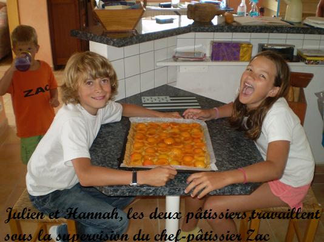

**Recette n°222 :** tarte aux abricots

## Ingrédients

  pour 6 personnes
- une pâte sablée ou feuilletée toute faite (pur beurre si possible)
- pour la crème d'amandes :
    - 100 gr de beurre
    - 100 gr de sucre
    - 2 oeufs
    - 100 gr de poudre d'amandes
    - 2 cl de rhum
  - pour le reste :
    - 1 kg d'abricot s
    - 50 gr de sucre
    - 2 cuillères à soupe de confiture ou de gelée d'abricot

## Préparation

1 - Mettre le vfour à préchauffer à 180 C
2 - Mettre la pâte au fond du moule à tarte.
3 - Préparer la crème d'amandes :
    3 - 1 - Ramollir le beurre
    3 - 2 - Ajouter le sucre et fouetter énergiquement
    3 - 3 - Ajouter les oeufs et fouetter encore.
    3 - 4 - Ajouter la poudre d'amandes.
    3 - 5 - Ajouter le rhum.
4 - Déverser la crème sur la pâte.
5 -  Disposer les abricots dénoyautés et coupés en deux.
6 - Saupoudrer de sucrre.
7 - Enfourner et cuire 45 minutes environ.
8 - Réchauffer la gelée d'abricot pour la liquéfier.
9 - Sortir la tarte du four et badigeonner le dessus de gelée avec un pinceau.

## Observations

Recette préparée à Quiberon le 17 juillet 2009 pour les familles Béclin et Mathews (en doublant les doses, bien sûr) qui ont beaucoup apprécié.
