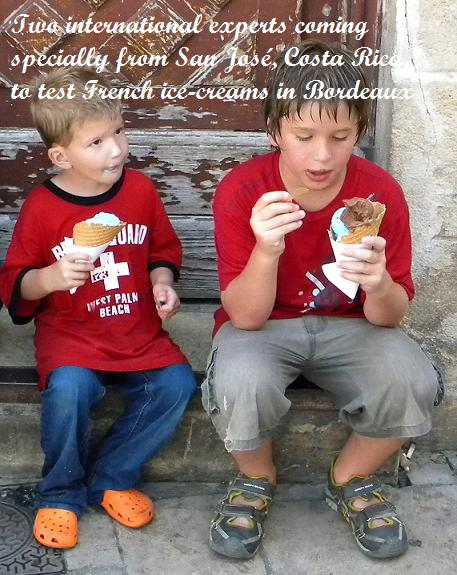

**Recette n°223 :** sorbet à l'orange, façon orange givrée

## Ingrédients

  pour 8 personnes
- un litre de jus d'orange
- le jus et le zeste d'un grtos citron jaune
- 400 g de sucre
- 2 cuillersà soupe de cointreau

## Préparation

1 - mélanger le tout à la cuiller jusqu'à complète disolution du sucre.
2 - mettre à refroidir une heure dans le compartiment glace du réfrigérateur.
3 - passer à la sorbetière trois quarts d'heure environ.
4 - extraire de la sorbetière, mettre en bac à glace et placer au congélateur en attente de consommation.

## Observations

Recette préparée à Quiberon le 1er août 2009 pour le dernier dîner breton des Mathews en 2009 ; une façon de faire une excellente glace à l'orange sans oeufs ni crème fraîche.
