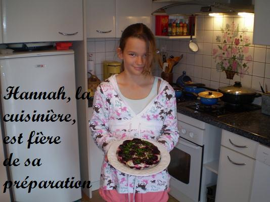
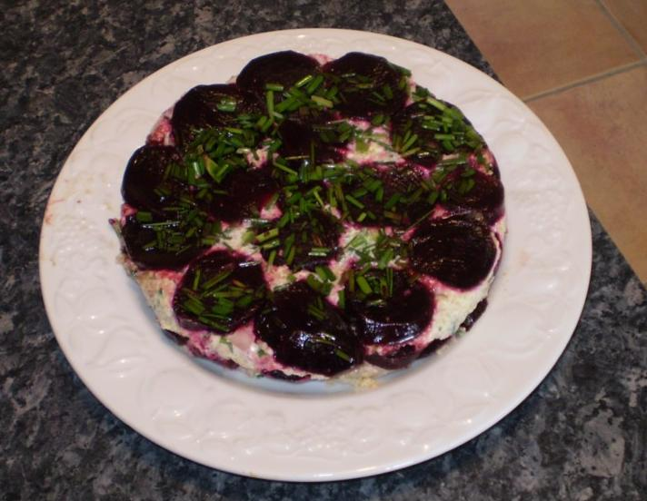

## Ingrédients

*Pour 8 personnes*

- 100 g de quinoa cuit et refroidi
- 250 g de fromage blanc frais battu
- 2 betteraves rouges cuites, épluchées et coupées en rondelles régulières
- 20 brins de ciboulette fraîche ciselée
- 2 échalotes finement hachées
- 2 cuillères à soupe d'huile d'olive
- 1 cuillère à soupe de vinaigre de vin
- Sel et poivre au moulin

## Préparation

1. Tapisser l'intérieur d'un moule à gâteau ou d'un moule à charlotte d'une grande feuille de film alimentaire transparent.
2. Parsemer le fond du moule avec la ciboulette finement ciselée.
3. Dans un premier saladier, assaisonner les rondelles de betteraves avec sel, poivre et un filet d'huile d'olive.
4. Dans un second saladier, mélanger le fromage blanc, le quinoa cuit refroidi, les échalotes hachées, l'huile d'olive, le vinaigre, du sel et du poivre.
5. Monter le gâteau en disposant alternativement dans le moule une couche de rondelles de betteraves et une couche de préparation au quinoa et fromage blanc.
6. Rabattre le film étirable sur le dessus et tasser légèrement.
7. Placer au réfrigérateur pendant au moins 4 heures pour bien raffermir la terrine.
8. Au moment de servir, ouvrir le film et démouler délicatement sur un plat rond. Servir bien frais en tranches.

## Observations

- **Contexte :** Une entrée estivale originale, colorée et très rafraîchissante qui surprend agréablement par le contraste de textures.

