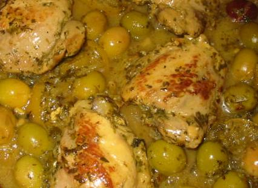

**tajine de poulet aux légumes et aux citrons confits**

Ingrédients pour 8 personnes :
- 8 cuisses et heuts de cuisses de poulet de Loué
- 200 g d'olives vertes dénoyautées
- 3 citrons confits
- 8 carottes moyennes
- 2 oignons épluchés et ciselés
- une grosse courgette
- 10 g de raisins secs
- 100 g de pruneaux dénoyautés
- 2 cuillers à café d'épices à tajine, par exemple de chez Ducros
- huile d'olive.
- sel et poivre selon goût.

## Préparation

- préchauffer le four à 120C
- couper carottes et courgette
- faire revenir le poulet sous ses deux faces à la sauteuse avec de l'huile d'olive
- ajouter l'oignon émincé et faire revenir à feu plus doux encore 5 minutes
- ajouter un dmi-litre d'eau ; ajouter l'ail, le curcuma, le cumin, le ras el hanout, le paprika, le gingembre
- saler et poivrer très légèrement
- ajouter olives, courgette en tronçons, carottes, épices et citrons confits
- verser le tout dans une cocotte en fonte (c'est mieux que le plat à tajine), ajouter pruneaux et raisins secs ; couvrir et mettre au four pendant 2 heures
- en fin de cuisson, goûter et ajuster sel et poivre selon goût
- servir de préférence dans la cocotte de cuisson

## Observations

1 - recette préparée en août 2009 pour la famille Mathews à Quiberon ; très apprécié avec du quinoa et de la graîne de couscous comme légumes.
2 - surout ne pas touiller pendant la cuisson (ni ensuite d'ailleurs)
