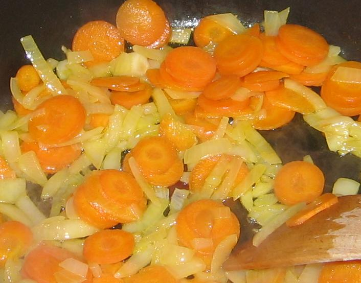

**Recette n°230 :** Soupe de chicons légère et facile

## Ingrédients (pour 6 personnes)

- 3 endives grosses
- 2 carottes moyennes
- 2 oignons jaunes moyens
- 2 pommes de terre grosses
- 2 litres d'eau
- 2 cuillers à soupe rases de matière grasse (une de margarine ou beurre, une d'huile)
- 4 cubes de bouillon de poule ou de boeuf

## Préparation

1 - éplucher les pommes de terre, les couper en 8, les mettre dans l'eau froide avec les cubes de bouillon dans une grande casserole et faire cuire.
2 - nettoyer les carottes et les débiter en rondelles, peler et débiter en rondelles les oignons.
3 - faire revenir oignons et carottes dans une sauteuse avec la matière grasse en remuant beaucoup (les oignons doivent se colorer légèrement mais surtout pas brûler, les carottes doivent devenir tendres sans brûler)
4 - mélanger carottes et oignons avec les pommes de terre qui cuisent, et poursuivre encore la cuisson du tout dix minutes environ.
5 - passer tout au mixer et remettre dans la casserole de cuisson à feu doux.
6 - nettoyer (si nécessaire) et débiter en tranches de 1 cm environ les endives, les mettre dans le bouillon, remuer délicatement et poursuivre la cuisson à feu doux une dizaine de minutes environ.

## Observations

- recette exécutée le 26 septembre 2009 à Quiberon pour Andrée et Michel Pioger et nous deux; excellente après une balade dans le vieux Vannes et un pot sur le port de Saint-Goustan
- on peut dervir avec de la crème fraîche si on est gourmand (nous ne l'avons pas fait), avec du yaourt si on veut refroidir (Mamy l'a fait), mais c'est bien meilleur sans rien d'ajouté.
- surtout ne pas saler a priori car les cubes de bouillon salent déjà assez ( selon nous).
- cette recette est très proche de la recette n°88 (crème de chicons d'Isabelle de Marcy), mais est plus légère car la farine a été remplacée par de la pomme de terre et on n'y met pas de crème fraîche a priori..
