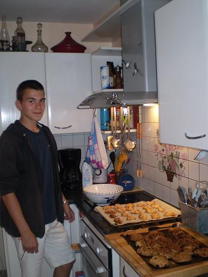
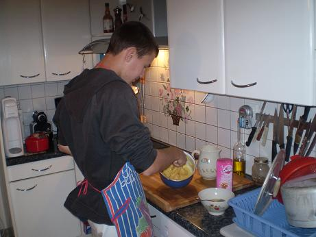

## Ingrédients (pour 40 chouquettes, dessert pour 5 personnes)

25 cl d'eau
125 g de farine
60 g de beurre
1 pincée de sel
50 g de sucre
4 oeufs
100 g de sucre en perles

## Préparation

0 - préchauffer le four à 180C
1 - mélanger eau, beurre, sucre dans une casserole et chauffer en remuant
2 - porter à ébullition en remuant, puis retirer du feu
3 - verser la farine en une seule fois, mùélanger avec une cuiller en bois jusqu'à ce qu'il n'y ait plus de grumeaux,
4 - remettre sur le feu et remuer la pâte jusqu'à ce qu'elle se détache des parois et ne forme plus qu'une boule,
5 - retirer du feu, laisser refroidir une minute, puis incorporer les oeufs un par un en remuant,
6 - sur deux plaques de four, mettre deux feuilles de papier sulfurisé, et disposer les chouquettes en les espaçant,
7 - couvrir les chouquettes de sucre en perles,
8 - enfourner à four préchauffé à 180C et laisser cuire 20 minutes environ.

## Observations

Recette faite à Quiberon le 15 juillet 2011 par Yohan William Gabriel Béclin ; très bon mais pas régime du tout !

Une photo :

