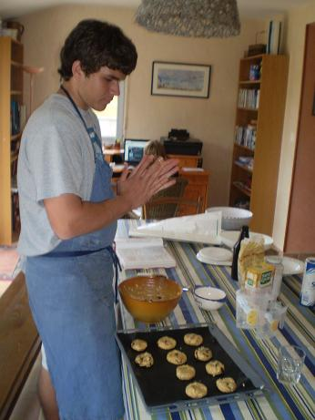
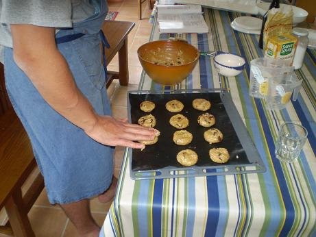

## Ingrédients (pour 18 cookies de taille moyenne environ)

- 150 g de beurre fondu mais non brûlé
- 2 cups de farine
- 1 cup de sucre roux
- 1/2 cup de sucre cristallisé
- 2 œufs
- 1 cuiller à café de levure alsacienne (chimique)
- 1 cuiller à café de vanille liquide
- 1/4 cuiller de bicarbonate de soude
- 2 cups de flocons d'avoine
- 1 cup de raisins secs éventuellement

## Préparation

1 - préchauffer le four à 200C
2 - mélanger tous les ingrédients (sauf le sucre crist.) en commençant par la farine et les œufs
3 - sur un papier sulfurisé posé sur la plaque du four, poser les cookies en boule, les aplatir à la main, et les saupoudrer du sucre cristallisé
4 - enfourner et cuire 10 minutes environ (ne pas trop cuire car les cookies deviennent vite durs)

## Observations

Recette préparée le 15 juillet 2011 à Quiberon par Samuel. Très bon.
Refaite avec Yohan William Gabriel Béclin en août 2011 ; toujours très bon.

|  |  |
|-------------------------------------------------------------------------|------------------------------------------------------------------------|
