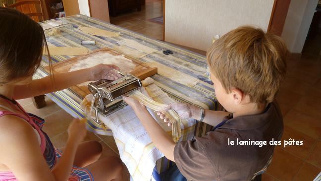
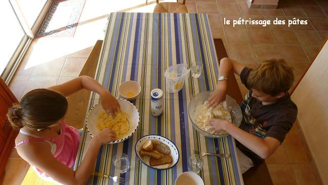
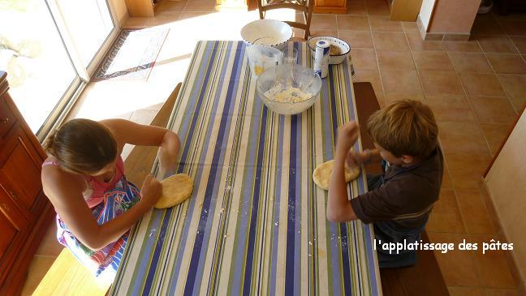
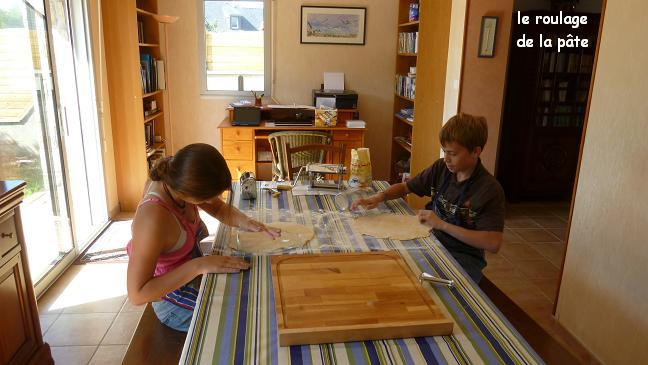
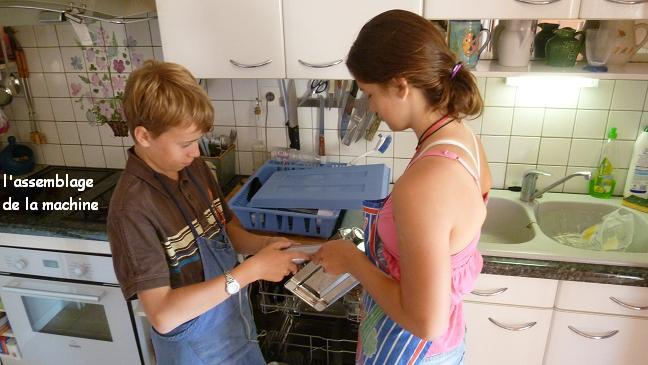
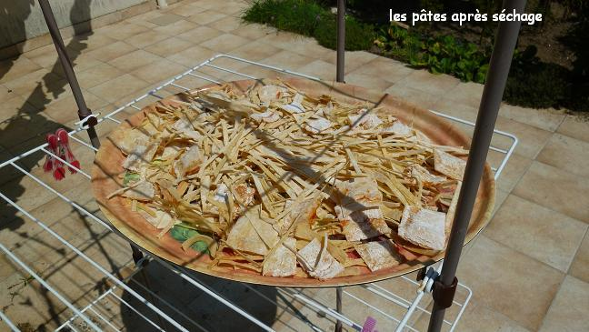

Recette n°239 : pâtes fraîches "maison" des deux cousins (Hannah Michelle Mathews et Julien Yann Raphaël Béclin)

## Ingrédients (pour 8 personnes, soit environ 850 g se pâtes après séchage)

- 700 g de farine de blé
- 6 oeufs
- un quart de verre d'eau
- une grosse pincée de sel

## Préparation

1 - mélanger oeufs et farine en mettant l'eau progressivement
2 - rouler et retourner plusieurs fois jusqu'à abtenir une boule de pâte bien homogène
3 - mettre à reposer 15 minutes au réfrigérateur
4 - abaisser en plaque qu'on lamine avec la machine à pâte jusqu'à obtention d'une couche fine
5 - passer à la machine à pâtes pour faire les pâtes désirées (tagliattelle, vermicelles, caneloni)
6 - mettre à sécher au séchoir à linge pendant 3 heures environ
7 - cuire comme des pâtes fraîches, c'est-à-dire 2 minutes environ
8 - servir avec la sauce souhaitée

## Observations

1 - Recette effectuée par les deux cousins le 14 juillet 2011 à Quiberon (voir photos)
2 - Excellent, mais un peu désespérant (beaucoup plus de temps pour la préparation que pour l'ingestion) !
3 - quelques photos

