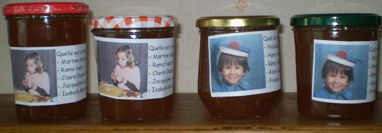

## Ingrédients

- 1kg de pommes
- 1kg de poires
- 750ml de sirop de cassis
- 2kg de sucre cristallisé
- 2 verres d'eau

## Préparation

1 -enlever queues et pépins des fruits, laisser leur peau
2 - mélanger fruits, sirop de cassis et eau, porter à ébullition
3 - ébouillanter pots et couvercles (compter 4 pots moyens par kg de mélange)
4 - à partir de 15 mn d'ébullition, contrôler toutes les 5 mn la viscosité du mélange (1)
5 - quand la viscosité souhaitée est atteinte, remplir les pots (progressivement pour qu'ils n'éclatent pas), les boucher, les retourner
6 - quand les pots sont refroidis, les remettre à l'endroit, les étiquetter et les stocker.

## Observations

Recette préparée en juillet 2011 à Quiberon par Julien (13 ans) et Zachary (6 ans). Très bon.

(1) une cuiller de jus déposée sur une soucoupe froide ne doit plus couler quand on incline la soucoupe.
