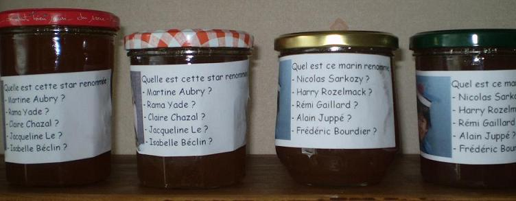
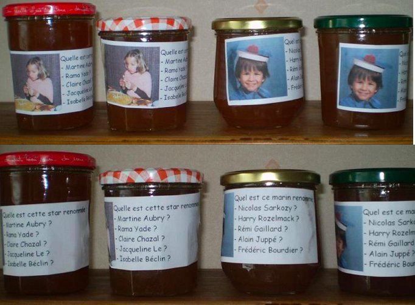

## Ingrédients

- 1 kg de pommes
- 1 kg de poires
- 750 ml de sirop de cassis artisanal
- 2 kg de sucre cristallisé
- 2 verres d'eau

## Préparation

1. Laver les fruits ; retirer les queues et les pépins tout en conservant la peau des pommes et des poires.
2. Découper les fruits en morceaux et les déposer dans une bassine à confiture avec le sirop de cassis et les 2 verres d'eau.
3. Porter le mélange à ébullition en remuant à la cuillère en bois.
4. Ébouillanter les pots et les couvercles (compter environ 4 pots moyens par kilo de préparation).
5. À partir de 15 minutes d'ébullition, contrôler la viscosité toutes les 5 minutes à l'aide d'une soucoupe froide (une goutte déposée sur la soucoupe inclinée ne doit plus couler).
6. Dès que la consistance est atteinte, remplir les pots progressivement pour éviter les chocs thermiques, visser hermétiquement et retourner les pots sur un torchon.
7. Une fois les pots entièrement refroidis, les remettre à l'endroit, les étiqueter et les stocker dans un endroit frais et sombre.

## Observations

- **Contexte :** Recette préparée en juillet 2011 à Quiberon par Julien (13 ans) et Zachary (6 ans) : un délice fruité très réussi !

