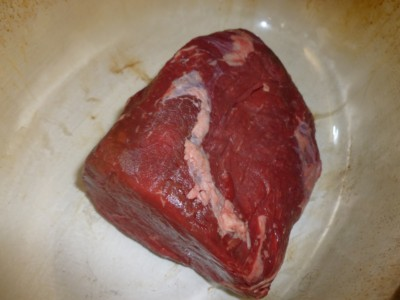
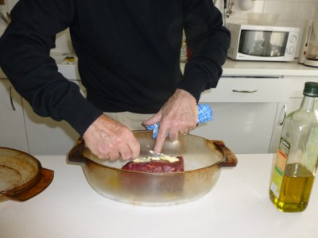
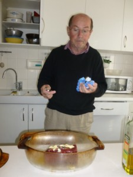
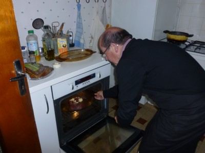
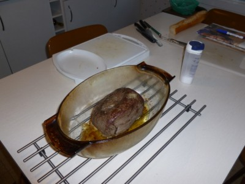
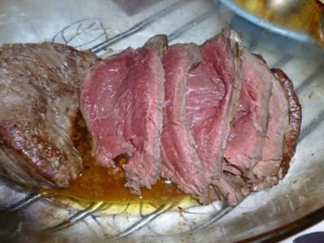

## Ingrédients

Pour 6 personnes :

- 900 g de rumsteak
- 4 cuillers à soupe d'huile de tournesol ou d'arachide ou de colza (pas d'olive)
- 4 cuillers à soupe de beurre
- une grosse pincée de gros sel
- une grosse pincée de poivre

## Préparation

- préchauffer le four à 240C
- dans un plat à hauts bords allant au four, mettre l'huile

- y déposer ensuite la viande
- sur la viande appliquer le beurre en pommade

- enfourner à four chaud et laisser cuire entre 25 et 30 minutes suivant qu'on aime bien cuit ou pas

- sortir, saler, poivrer, découper et servir aussitôt

## Observations

- recette effectuée à Quiberon le 22 septembre 2011 par le chef Michel Pioger en personne : excellent !
- se sert avec des pommes de terre rôties, du chef Michel Pioger également (cf. recette n°250) : attention au timing car viande et patates doivent être servies chaudes et simultanément.
