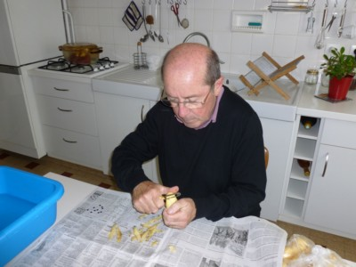
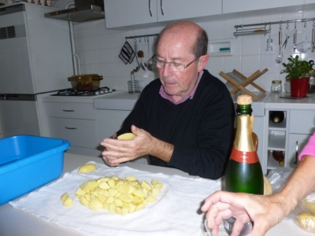
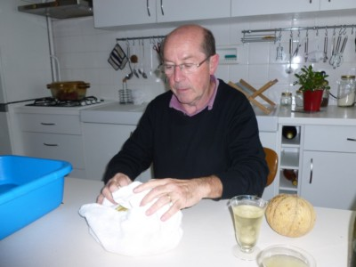
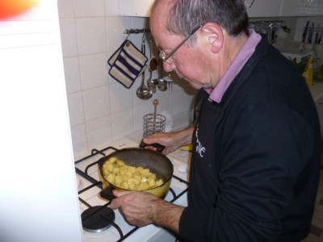

## Ingrédients

*Pour 6 personnes*

- 1,5 kg de pommes de terre à chair ferme (variété Charlotte)
- 4 cuillères à soupe d'huile de tournesol ou d'arachide
- 60 g (4 cuillères à soupe) de beurre demi-sel
- 1 grosse pincée de gros sel de Guérande

## Préparation

1. Éplucher les pommes de terre et les réserver au fur et à mesure dans un récipient d'eau fraîche pour éviter qu'elles ne s'oxydent.

2. Découper les pommes de terre en morceaux réguliers (en 12 quartiers pour une pomme de terre de 100 g).

3. Déposer les morceaux de pommes de terre dans un torchon propre et les éponger soigneusement pour retirer tout excès d'eau.

4. Dans une grande cocotte, déposer le beurre et l'huile et faire chauffer à feu très vif.
5. Dès que le mélange de beurre et d'huile commence à mousser, verser les pommes de terre en une seule fois.
6. Secouer vivement la cocotte pour que la matière grasse enrobe uniformément chaque morceau.

7. Laisser rissoler à feu vif pendant 10 minutes en remuant très délicatement deux à trois fois au maximum avec une cuillère en bois.
8. Poursuivre la cuisson douce pendant encore 10 à 15 minutes sans trop remuer pour obtenir une croûte bien croustillante et dorée.
9. Égoutter l'excès de matière grasse, remettre en cocotte, saupoudrer de gros sel et maintenir au chaud jusqu'au service.

## Observations

- **Contexte :** Recette exécutée à Quiberon le 22 septembre 2011 par le chef Michel Pioger en personne.
- **Service :** Accompagnement idéal du rôti de bœuf du chef Michel Pioger (recette n°249) : ajuster le timing pour les servir ensemble bien chauds.
- **Astuce légèreté :** L'égouttage de l'excès de graisse en fin de cuisson permet d'alléger considérablement le plat sans rien perdre de son croustillant.
